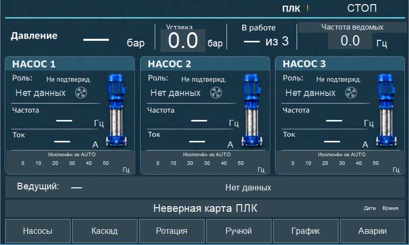
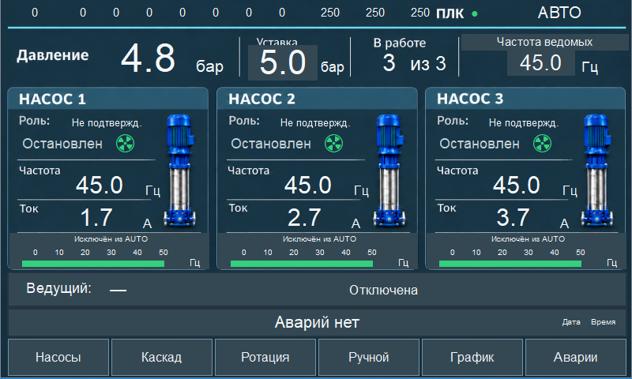
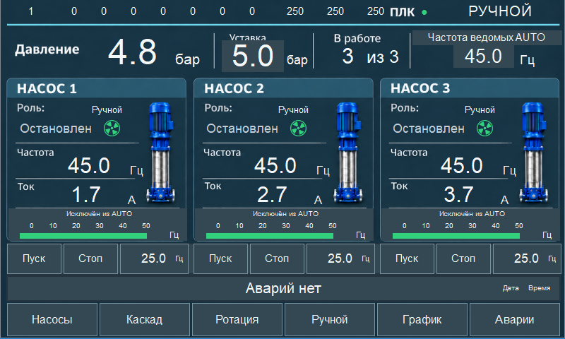
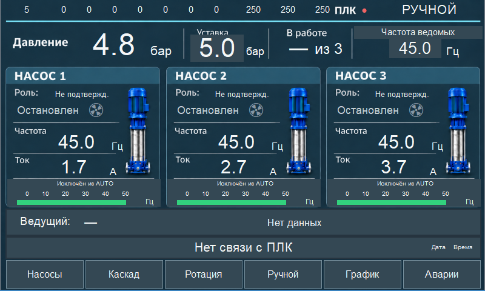
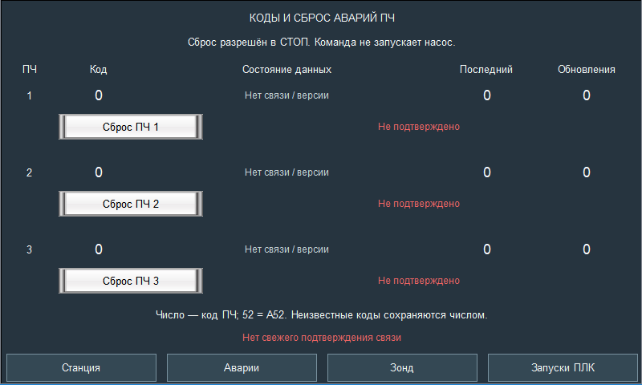

# Бабанов r21: Main MANUAL и тёмные служебные страницы

**Отдельный native r21 изготовлен и проверен локальным Codex без оборудования.**
Основа сохранена; PLC не пересобирался. Задание и утверждённые spec/layout/PNG
получены из одного коммита `eb6e0064c8cb13a5a01725b629b04e0381a9051a`.
Проверено24.11.2026 на Windows, SKTOOL7.1 / SK-070HE800×480,
ветка/worktree `codex/telemetry-r19-local-20261117`.
Dirty-корень5e3cbae и два ранее открытых редактора r20 не перезаписывались;
для задания использованы отдельные экземпляры и приватные копии.

## Итоговый файл

```text
C:\Users\user\CodexProjects\pump-station\.worktrees\station002-fault-reset-local-15\_release_private\Бабанов_R21_Main_2026-11-24\pump_station_3p_babanov_r21_main_manual_native.skm
```

**1591509байт**, SHA256 `650a295dc7e842a33ee3c8ed1e2cf01364eb62085862a844aab148c9cbbe92bd`.
Исходная r20 по-прежнему1472535байт/SHAdaaeb096…01534.
Native SaveAs выполнен редактором, после него файл независимо открыт с диска.
Локальные manifest/README, полные дампы, Windows-тесты и снимки — рядом с SKM.
Внешние StaticPicture/assets и установленный Pump Station Rotor сохранены;
их пути/хеши перечислены в приватном `FINAL_NATIVE_MANIFEST.json`.

## Реализация

- Удалён реальный Main SB6010 с областью нажатия. Шесть оставшихся переходов
  ведут на Screen6/2/3/7/8/9. Screen4 и пути к нему с других страниц сохранены.
- Исходный PNG не перерисован. Новые нативные непрозрачные Rectangle без touch
  закрывают запечённые деления/полосу/«Ведущий». Статус y296, шкала y315,
  настоящий BG y330; ручной ряд346..386, аварии392..424, footer430..474.
  Нативные подписи/деления/Гц и тонкие рамки не перекрывают живые контролы.
- С Screen7 клонированы полные BB9028/9032, NE9018; BB9056/9060, NE9046;
  BB9084/9088, NE9074. Новые Main id — BB94000/94001, NE94002;
  BB94010/94011, NE94012; BB94020/94021, NE94022.
  Адреса M380..382/M384..386/R2180..2182, Invert/Press execute,
  монитор/отпускание, guards M1530..1532 и M1534, формат/границы100..500raw
  сохранены. У Стоп сохранены прежние условия связи/контракта; M1533
  отсутствует в выбранных исходных контролах.
  M1660..1662/«Повторить» на Main не переносились.
- Новый C — только маска отображения LW980..982/LB1260. Свободный диапазон
  сверён с прямыми и косвенными обращениями: прежние LW970..979,
  LW950..958, LW51000..51031 и LB1250..1252 не пересекаются с ним.
  Ручной показ требует LB60107, MapVersion32, AlarmWords[2]=1 и R2300
  в20/21/22 через прежние native aliases. Дополнительно каждый новый контрол
  сохраняет R2329=27110 через нативный Logic control, а собственный interlock
  остаётся в полном клонированном объекте. Видимость не заменяет блокировки.
  Показаны «Ручной» и «Частота ведомых AUTO»; вне MANUAL работает прежняя сводка.
- LB810 изменён только с target6 на0 — реальный Main. Trigger/Automatic Reset,
  LB811/target16, механизм эпизодов, звук/mute/reset и прежние C-службы сохранены.
- Служебные формы получили фон#26343F/панели#344854 и обычный светлый текст;
  на светлых вводах оставлен тёмный. Перекрашены также старые фоновые объекты,
  включая светлый фон15/16. В статусах ПЧ исходные серый/зелёный/жёлтый/красный
  переведены в соответствующие контрастные цвета текста на тёмной панели;
  количество состояний и их подписи/значения не изменены.
  Графики/оси/светлые поля сохранены, нижняя навигация обрамлена.
  Внутренние рабочие кнопки не превращались в переходы.
  LOGO/фото/постер РКФ и контролы памятки сохранены.

## Фактические проверки

| Проверка | Результат |
|---|---|
| SaveAs → независимый reopen | PASS |
| Script Compile production HMI/local | **0errors/0warnings /0/0** |
| Весь HMI | **The project was compiled successfully / Finished to compile** |
| Download | Не выполнялся; диалог USB0% закрыт |
| Production Offline Simulator | PASS, финальный файл без тестового номера/ручных подмен |
| Main6переходов | Все6нажаты из Main, реальные цели/возвраты PASS |
| Прочие страницы |16разных страниц Simulator; LOGO просмотрен в native Editor |
| Новый actual C на Windows x86gcc |264случая PASS, входы/прочие слова/биты не изменены |
| Прежний actual PanelHelpers на Windows |8проверок первого сэмпла/входа/сброса/нового эпизода/связи PASS |
| Protected properties |586прежних объектов +9клонов PASS;17страниц/7групп |
| Production C/packed bindings |Прежний C восстанавливается точно; F/Q/I, R2100/R2110 и variable rows сохранены; TEST hooks/bindings отсутствуют |
| PLCnative |SHAe163898006de80a0f88bc1f3b9d663860c4bc15c82dbc405cf73882e75276702, без изменений |

TEST_ONLY создан отдельно от финального SHA выше. Команды перенаправлены
в LB1600..1605, частоты в LW1600..1602; вектор запросов/заданий выведен
дополнительными локальными индикаторами. Эти элементы не входят в production.
Проверены шесть отдельных жестов Пуск/Стоп: только свой запрос;
частоты375/500/100raw меняли только свой канал, без Пуска/Retry.
Клавиатура принимает10.0/50.0 и отвергает9.9/50.1.
AUTO/STOP/потеря связи/неверная карта скрывают ручной ввод; MANUAL20/21/22,
запрет пуска2-го канала и занятая частотная очередь сохраняют guards.
Удерживаемый Пуск при скрытии ряда в AUTO и отпускании не дал второго запроса.

Отдельный синтетический совместный импульс нативных LB810/LB811 открыл РКФ;
после закрытия Main остался доступен без цикла, переход на7 не вытеснялся.
Это проверка нативного маршрутизатора запросов; реальный источник переключателя
проверен здесь host-тестом сохранённого PanelHelpers, не оборудованием.

Simulator production без PLC показывает «Неверная карта ПЛК» при MapVersion0,
неизвестные F/I и скрытый ручной ввод. Это ожидаемый offline-кадр, не новое
измерение реальной связи/карты. Синтетические данные не вводились в production.
Реальные Modbus/приводы/interlocks/новая авария питания/реальная панель
остаются **PENDING**. Download/Force/RUN/Apply и аппаратных команд0.

Дополнительный strict web-аудит вернул2 из-за прежних HTML-макетов
(native-select ownership/демонстрационные кнопки); web-файлы не менялись.
Он не является Compile или проверкой native HMI и не объявлен PASS.

## Свежие снимки

Production без оборудования:


**Следующие кадры — исключительно TEST_ONLY, не production.**
Селектор и верхний вектор запросов принадлежат испытательной копии.





Служебная страница production:

