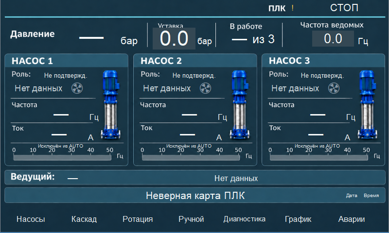

# r20: проверка верхнего поля и финального снимка 24.11.2026

**Тестового элемента в production нет. Ремонт и r20a не понадобились.**
Замечание о «0» на историческом production-offline не подтвердилось по
байтам изображения из Git. Номер сценария принадлежит отдельным TEST_ONLY
кадрам, а не проверенному native r20.

Проверено самим локальным Codex24.11.2026 на Windows/SKTOOL7.1,
SK-070HE800×480, после чтения HANDOFF и
[задания](../tasks/station002-main-r20-final-proof-local.md).
Git-база `49c2a5ada8f0ceb616be57c065fc6a48c0fbdd5f`, рабочая ветка
`codex/telemetry-r19-local-20261117`. При начале SKTool/Simulator не работали,
пользовательского открытого RAM-буфера не было. Перенос Main не повторялся.

## Дисковый файл

```text
C:\Users\user\CodexProjects\pump-station\.worktrees\station002-fault-reset-local-15\_release_private\Бабанов_R20_Main_2026-11-17\pump_station_3p_babanov_r20_main_native.skm
```

Размер **1472535байт**, SHA256
`daaeb096a890716cb2151604724293b77139f74cd49bf0a1ea27f9e7bb801534`.
Размер/хеш совпали до и после проверки. SKM не перезаписывался.
Сначала открыт NATIVE_MACRO_READY, затем именно этот production через
File→Open. Полное окно с путём/заголовок и доказательства свойств сохранены
приватно в подкаталоге `final-proof-20261124` рядом с native.

## Что находится сверху слева

| Файл/объект | Тип и адрес | Видимость/назначение |
|---|---|---|
| Production MD3062 | Message Display, uint16 R2301; x16,y4,510×27 | Native Visibility: Word control **R2301 <> 0**. При0 скрыт; ненулевые состояния выводят прежние причины AUTO. Не числовой индикатор номера сценария. |
| TEST_ONLY NE92999 | Numeric Input, uint16 LW1450; x16,y3,65×25 | Отдельный переключатель сценария. В тестовых кадрах показывает0/2/…; в production отсутствует. |
| Production ND10048/ND10050/ND3060/ND3026 | R2525/R2526/R2130/R2131, x410/448/486/524,y21 | Прежние счётчики/перезапуск; каждый виден при своём слове <>0. Сохранены. |

Привязка и знак `<>` MD3062 прочитаны как из сериализованных свойств,
так и из настоящего диалога редактора; диалог закрыт Cancel.
MD3062 имеет32текстовых состояния и тот же источник/условие, что до переноса.
Селектор NE92999, LW1450, TEST_ONLY hook и тестовые присваивания найдены
в приватном `TEST_ONLY_R20_RENDER_v4.skm`, но не в production.

Проверен весь Main, включая packed-address strings, а не только строки C:
реальные R2500..2/R2510..12 и LW960..965 на месте; переназначений Main
на тестовые LW920..925/LW1460..1476 нет. Оба C-зеркала совпадают между
собой и с native-моделью после добавления MainOverview, UTF16SHA
`da69c5eabd88641212cf0b178c3656cab7175f22a286af1b15003b021e59c61e`.
MainOverview/прежние guards и привязки не менялись.

## Почему возник вопрос к изображению

Исторический `station002-r20-production-offline.png` из4732216 и49c2a5a —
**один Git blob** `c93ef5759304167a999954f50b8cd1e72af66702`, SHA256
`8bf1597ebc37a5682330b502a2ba1f9611060b24f0666bd839482b54dae21f6b`.
На нём нет номера слева. Свежий захват production Simulator24.11 дал
**побайтно такой же PNG**: Main не содержит часов и без оборудования
показывает те же исходные недостоверные данные.

Дополнительная проверка области селектора x16..80,y3..27:
на старом и новом production0светлых пикселей, на TEST_ONLY normal28.
Визуальный осмотр всех трёх кадров согласуется с этим сравнением.
Причину ошибочного визуального прочтения в облачном сеансе установить нельзя;
подмену production-кадра тестовым и утечку элемента в SKM байты не подтверждают.
Исходные normal/unknown остаются явно обозначенными TEST_ONLY доказательствами.

## Свежие native-проверки

- Script Compile: HMI **0errors/0warnings**, local **0/0**, Compile success.
- После Script Compile редактор предложил Save перед whole-project Compile.
  Сохранение отменено; служебный RAM не записан поверх r20, файл вновь
  загружен с диска. Затем whole-project Compile завершился **The project
  was compiled successfully / Finished to compile** без сохранения SKM.
  Диалог Download0% закрыт без Download.
- Offline Simulator запущен именно из production и повторно после полного
  Compile. Слева сверху пусто, нет номера сценария. Показания F/I неизвестны;
  «Неверная карта ПЛК» соответствует simulatorMapVersion0 без оборудования.
- PLC-файл по-прежнему SHA
  `e163898006de80a0f88bc1f3b9d663860c4bc15c82dbc405cf73882e75276702`.
  Оборудование/ПЛК/радио/SCADA не менялись; Download/Force/RUN/Apply0.
  Старую матрицу ввода/переходов/РКФ заново не запускали. В production
  синтетические данные не вводились. Аппаратные проверки остаются pending.

Обновлены только доказательства, отчёты и локальные manifest/README.
Нового SKM нет: итогом остаётся указанный неизменённый r20.
Приватные полные дампы/исходная копия до проверки — в `final-proof-20261124`.


