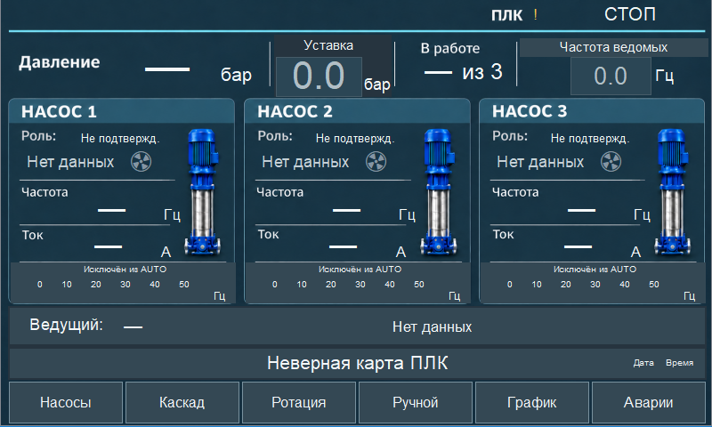
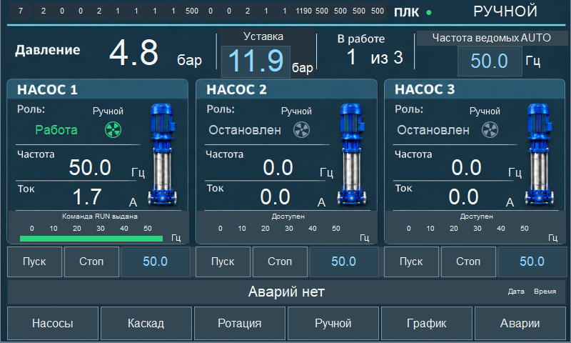
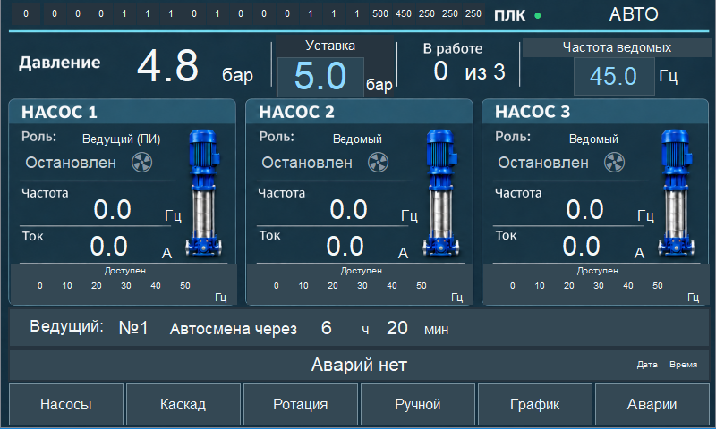
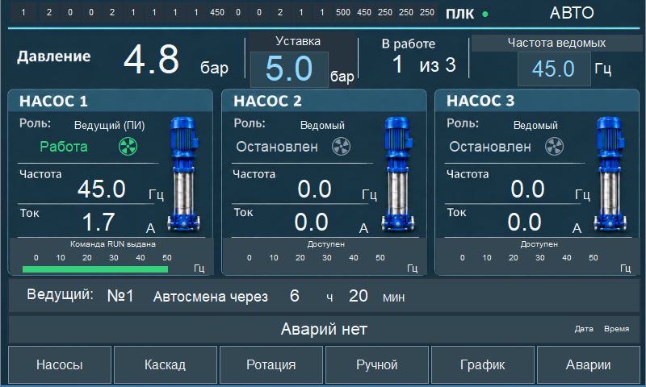
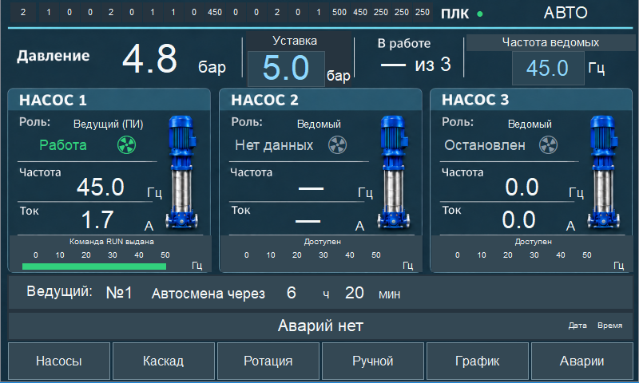

# Бабанов r21a: уставка, редактируемые числа и согласованные статусы

Локальный Codex,24.11.2026, Windows / SKTOOL7.1 / SK-070HE800×480.
Ветка codex/telemetry-r19-local-20261117, проверенная база
2abc02ea7f6d677445258e8744243a90afb906c1. Dirty-корень и пользовательские редакторы
r20/r21 сохранены; перенос Main заново не выполнялся.

## Итог

```text
C:\Users\user\CodexProjects\pump-station\.worktrees\station002-fault-reset-local-15\_release_private\Бабанов_R21a_Main_2026-11-24\pump_station_3p_babanov_r21a_main_manual_native.skm
```

**1658099 байт**, SHA256 `ebbf1a3c59e7e01d2e5dd15c4f72564b44c231f0f0cf16b03fc93bd38a0f2db7`.
Native SaveAs и независимое повторное открытие выполнены. После TEST_ONLY production
открыт с диска ещё раз; хеш не изменился. Исходная r21 сохранена:1591509байт,
SHA256 `650a295dc7e842a33ee3c8ed1e2cf01364eb62085862a844aab148c9cbbe92bd`.
Native, TEST_ONLY, полные дампы и manifest приватны рядом с итоговым SKM.

## Интерфейс и разрешения

ND3014/NE5002 перемещены вместе в[310,65,94,42], шрифт35 сохранён.
Старая bitmap-подпись закрыта пассивной подложкой[307,39,131,69]; одна native-подпись
[313,42,110,18], единица бар[405,84,36,21]. Фактические пиксели кадра11.9:
подпись y45..55, цифры y69..99, **13 пустых строк**. Обрезки/наложения нет.
Частота ведомых шрифт22, ручные15: уставка крупнее.

Все7 исходных числовых объектов (оба ND/NE слоя шапки и3 ручных):
цифры#8ED8FF, поле#2B4655, тонкая рамка#5B899F; disabled#B1BEC6.
Цвет изменён самим цифрам и Qt text cache. Ручные светлые картинки удалены.
Измерения/токи/счётчики#F4F7F8, подписи/единицы нейтральные, статусные цвета сохранены.

Production C в обоих зеркалах **побайтно равен r21**. Серое представление выполнено
native-видимостью, дополнительными read-only слоями и5 disabled-вводами с прежними
guards. Эти вводы видны только при ложном условии их touch guard, поэтому писать
не могут. Активность шапки=link+contract, ручных=MANUAL+contract+M1534.
16 сочетаний условий PASS: разрешения не расширены.
Сохранены17 экранов/7 групп аварий,605 исходных наборов свойств;
7 оригинальных числовых объектов изменены только в разрешённых UI-свойствах,
у единицы бар изменена геометрия. Привязки/таблицы статусов и алгоритмы сохранены.

## Причина старых противоречивых TEST_ONLY-кадров

**Ошибка fixture, а не production.** PumpAnimation→MainOverview вычисляли
состояния[2,2,2], зелёные фазы и счётчик3/valid1. Затем старый тест независимо
перезаписывал LW903..905=[1,1,1] («Остановлен»), оставляя фазы и счётчик.
Воспроизведено исполнением сохранённых функций. Старые кадры больше не являются
доказательством согласованных статусов; новый TEST_ONLY не перезаписывает выходы.

MD10004/10018/10032 → LW903..905:0Нет данных,1Остановлен,2Работа,3Подготовка,4Не готов.
MD70010/70011/70012 → LW900..902:0серый,1..4зелёные фазы.
ND92000 → LW970, достоверность LW971.
Новый тест задаёт один снимок F/Q LW1860..1872 для C aliases и UI F/Q,
затем исполняет настоящие неизменённые PumpAnimation→MainOverview→MainManualPresentation.
Состояния/вентиляторы/счётчик независимо не задаются.

| Случай | F raw | Q | LW903..905 | LW900..902 | LW970/971 |
|---|---|---|---|---|---|
| Остановлены |0,0,0|1,1,1|1,1,1|0,0,0|0/1|
| Первый работает |450,0,0|2,1,1|2,1,1|1..4,0,0|1/1|
| Второй неизвестен |450,0,0|2,0,1|2,0,1|1..4,0,0|1/0|

На Simulator третий случай даёт Нет данных/прочерки у второго, серый вентилятор
и недостоверный общий счётчик. Дополнительный host-прогон реальных функций:
80 quality/link/map сочетаний+3 согласованных сценария PASS; входы не записываются.

## Проверки

- Production и финальный TEST_ONLY Script Compile: HMI/local0ошибок,0предупреждений.
- Полная HMI-компиляция: The project was compiled successfully / Finished to compile.
  Download не нажимался, диалог закрыт, USB0%.
- Offline Simulator800×480: AUTO/MANUAL/СТОП, потеря связи, неверная карта,
  contract loss, busy и link+contract loss PASS.
- R2100 /100,0.1..11.9: оба края введены,12.0 отклонено.
- R2110 /10,20.0..50.0: оба края введены,19.9 отклонено.
- R2180..2182 /10,10.0..50.0: все3 клавиатуры и запись10.0/50.0/10.0,
  значение9.9 отклонено. Масштаб/формат/диапазоны/guards исходные.
- Серые шапка при link loss и ручные при busy клавиатуру не открывают.
- После тестов production повторно открыт: selector/debug/LW1800..1999/TEST_ONLY
  отсутствуют. Без оборудования ожидаются неизвестные показания/Неверная карта ПЛК.
- PLC неизменён:SHA256 e163898006de80a0f88bc1f3b9d663860c4bc15c82dbc405cf73882e75276702.
  Команд оборудованию/Download/Force/Run/Apply0. Аппаратная связь, реальные механизмы
  и аппаратные блокировки не проверялись.

## Свежие реальные снимки

Прямые PNG Windows Simulator, без ретуши/генерации. TEST_ONLY сверху имеет selector
и raw-debug:LW900..905,970/971,F1..3,Q1..3,пять редактируемых raw. Production этого не имеет.



Верхняя сводка11.9 и MANUAL:



AUTO остановлены:



AUTO первый работает:



AUTO второй неизвестен:



[Minimum](station002-r21a/manual-min.png), [Disabled](station002-r21a/manual-disabled.png),
[Нет связи](station002-r21a/no-link.png),[Неверная карта](station002-r21a/wrong-map.png),
[СТОП](station002-r21a/stop.png),[Клавиатура уставки](station002-r21a/keyboard-setpoint.png),
[Ведомые](station002-r21a/keyboard-followers.png),[Ручная](station002-r21a/keyboard-manual.png),
[Отклонено12.0](station002-r21a/rejected-setpoint.png),
[Script Compile](station002-r21a/script-compile.png),[HMI Compile](station002-r21a/whole-compile.png).
