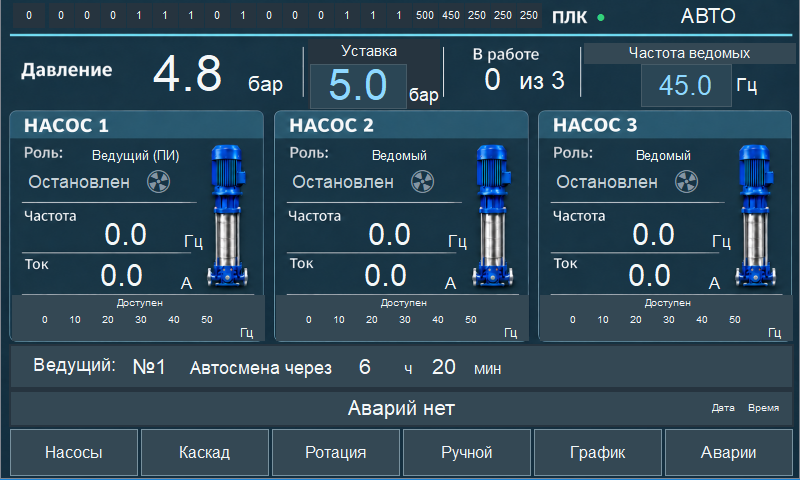
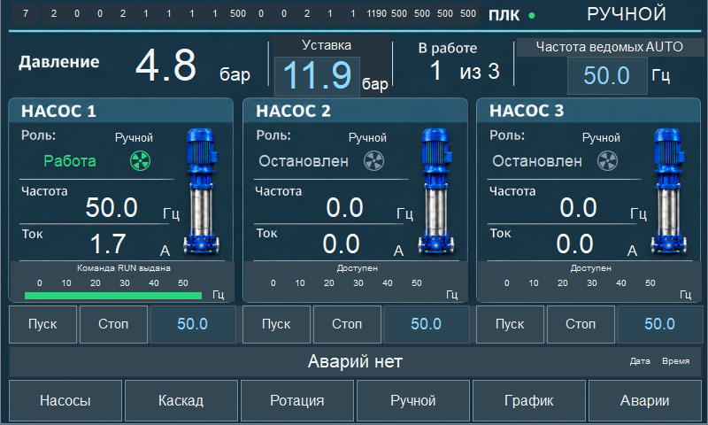
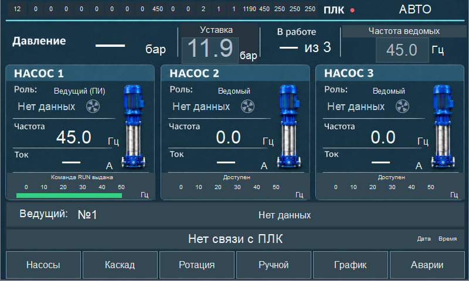
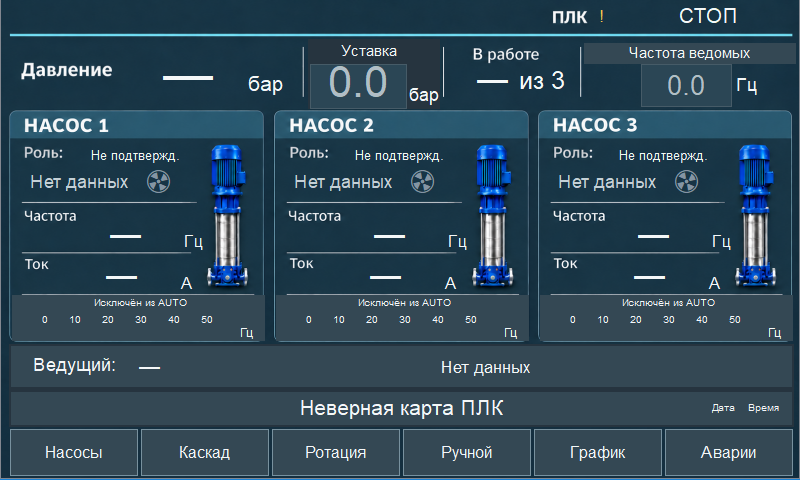

# r21a: сохранение пользовательского RAM и проверка именно его окна

24.11.2026, локальный Codex, Windows / SKTOOL7.1 / Offline Simulator800×480.
Пользовательское окно **PID8076** найдено по полному пути r21a. Сначала выполнен
native SaveAs его текущего RAM, затем Offline Simulator запущен из того же окна.
Другие редакторы r20/r21 не затронуты. Рабочая ветка codex/telemetry-r19-local-20261117,
начало d65a565; после чтения нового cloud follow-up принята база
`7d4c8c8d1f28369fcd626ddc5b3292d4354f4f9b`. Перенос Main не повторялся.

## Сохранённый пользовательский буфер

```text
C:\Users\user\CodexProjects\pump-station\.worktrees\station002-fault-reset-local-15\_release_private\Бабанов_R21a_Main_2026-11-24\user-window-20261124T1908\pump_station_3p_babanov_r21a_user_window.skm
```

**1657775байт**, SHA256 `47c1b616a84cd13915203a447e561cce792db802f1d79fcbfeb27a09b1fa679c`.
Этот файл не перезаписывался. Он отличается от выпущенной r21a:
ND96100 уменьшен с42до35px, NE96101 — с42до36.63934426229508px.
Свойства/цвета/форматы и productionC не изменены пользователем.
Native SaveAs также обновил кэши PNG HistoricTrend, что не является изменением
геометрии/логики этих трендов. Полные сравнения оставлены приватными.
Прежний выпущенный r21a1658099байт/SHAebbf1a3c…f2db7 сохранён.

## Установленная причина и минимальное исправление

Большое различие editor/runtime — предпросмотр. В редакторе одновременно видны
служебные адреса, числовые шаблоны и перекрывающиеся слои, включая скрываемые
в runtime. В сохранённом Qt-preview ND содержит88888, NE99999: это шаблонные строки,
а не данные R2100/R2110 и не причина менять их тип/точность/пределы.
Серый ND96100 расположен выше активной пары, поэтому редакторский серый шаблон
не доказывает отсутствие голубого цвета в рабочем режиме.

В Simulator из пользовательского окна активные5.0/11.9 и ведомые45.0/50.0
сразу были корректными голубыми числами на тёмной подложке, без захода на НАСОС2.
Однако в disabled-состоянии обнаружен **реальный маленький красный фрагмент под
цифрой**. Его причина установлена на TEST_ONLY-копиях из этого же RAM:
при отдельном показе NE96101 виден штатный красный знак запрета touch guard;
при отдельном ND фрагмента нет. После изменения пользователем высот ND35px
перестал полностью закрывать NE36.64px, и нижний край знака NE стал выступать.
Это не неверный цвет цифр и не ошибка диапазона.

Исправление: **только высота NE96101 приведена к пользовательским35px ND96100**.
Координаты x310/y65, ширина94, пользовательская высота ND35 сохранены.
Активная пара ND3014/NE5002 остаётся94×42, ведомые ND3018/NE5004 —88×40.
Все626 наборов свойств пользовательской модели совпадают до/после;
форматы/точность/диапазоны/привязки/visibility/touch guards неизменны,
productionC в обоих зеркалах побайтно тот же.64 standalone-подложки не изменены;
при SaveAs редактор только поменял порядок сериализации некоторых из них.

## Итоговая проверенная копия

```text
C:\Users\user\CodexProjects\pump-station\.worktrees\station002-fault-reset-local-15\_release_private\Бабанов_R21a_Main_2026-11-24\user-window-20261124T1908\pump_station_3p_babanov_r21a_user_window_checked.skm
```

**1657717байт**, SHA256 `52b782a6b9cf062a3b19ef106872340928c0ba4762ee4f5160f37b5b3a8432a3`.
Native SaveAs выполнен, итог независимо повторно открыт в том же PID8076,
после всех TEST_ONLY Simulator снова запущен из production в этом окне.
Хеш production после открытия/Simulator стабилен; тестовых aliases/слов/selector нет.
Именно этот checked-файл оставлен открытым, а не TEST_ONLY.

## Результаты

- Production Script Compile: HMI/local0ошибок,0предупреждений.
- Whole HMI Compile: project compiled successfully / Finished to compile.
  Download не нажимался, диалог закрыт с USB0%.
- Финальный TEST_ONLY, построенный из точного checked SHA, также Script Compile0/0.
  Все запускалось в том же редакторе PID8076; исходный RAM сначала сохранён отдельно.
- На TEST_ONLY проверены5.0/11.9, частота ведомых45.0/50.0, активный/disabled вид.
  Ввод/синтетические слова только локальные, команды оборудованию0.
- Клавиатура уставки показывает0.1..11.9, ведомых20..50; disabled нажатие клавиатуру
  не открывает. Типы/точность/пределы ради888 не менялись.
- После исправления в обеих числовых областях **0 красных пикселей**.
- PLC/аппаратная HMI не менялись; реальная связь/приводы не проверялись.

Измерения свежих PNG (точные пиксели цвета цифр):

| Случай | Уставка | Ведомые | Цвет | Фон обоих полей | Y цифр уставки/ведомых |
|---|---|---|---|---|---|
| AUTO разрешён |5.0|45.0|#8ED8FF|#2B4655|69..99 /75..94|
| MANUAL разрешён |11.9|50.0|#8ED8FF|#2B4655|69..99 /75..94|
| Нет связи |11.9|45.0|#B1BEC6|#2B4655|66..96 /75..94|
| Нет связи |5.0|45.0|#B1BEC6|#2B4655|66..96 /75..94|

Низ активных цифр y99, верх плашки НАСОС2 y111:11 полностью свободных строк;
сам заголовок начинаетсяy119, от цифр до него19строк. Disabled цифры заканчиваютсяy96,
то есть дальше от плашки. Фон/тонкая рамка не менялись. Поле уставки остаётся
крупнее ведомых; подпись и бар нейтральные, с достаточным отдельным местом.

## Свежие реальные доказательства

PNG непосредственно из Windows, без ретуши/генерации. В TEST_ONLY сверху selector
и raw-debug, в production их нет. Исходный editor-кадр и прямой Simulator
сохранены до исправления.

[Редактор до SaveAs](station002-r21a-user-window/editor-before.png),
[Simulator прямо из пользовательского окна](station002-r21a-user-window/user-window-direct.png).

Активные5.0 и11.9:





Disabled после исправления:



[Disabled5.0](station002-r21a-user-window/disabled-5.0.png),
[фрагмент ДО исправления](station002-r21a-user-window/before-disabled-11.9.png),
[изолированный NE со знаком запрета](station002-r21a-user-window/disabled-NE-isolated.png),
[клавиатура уставки](station002-r21a-user-window/setpoint-keyboard.png),
[клавиатура ведомых](station002-r21a-user-window/followers-keyboard.png),
[disabled без клавиатуры](station002-r21a-user-window/disabled-no-keyboard.png),
[Script Compile](station002-r21a-user-window/script-compile.png),
[Whole Compile](station002-r21a-user-window/whole-compile.png).

Production после независимого открытия:


