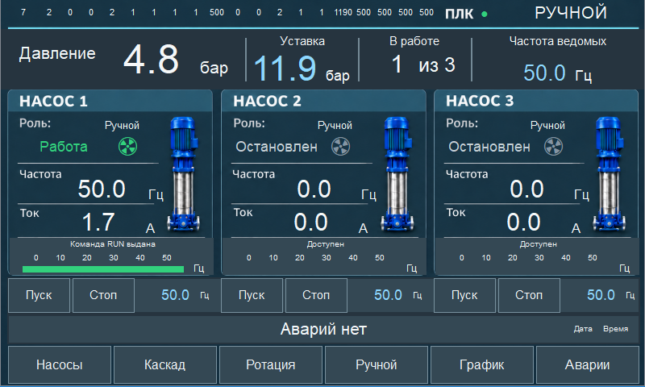
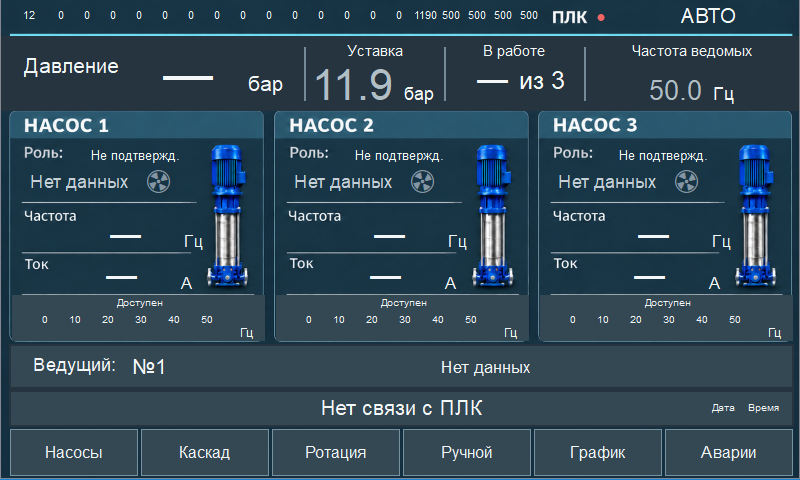
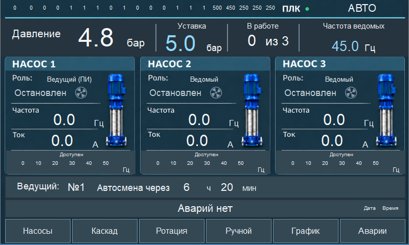
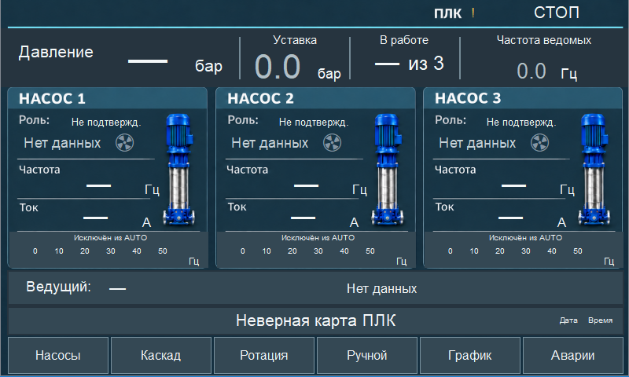

# Бабанов r21b: прозрачные поля и выровненная верхняя сводка

Выполнено 24.11.2026 локальным Codex на Windows, SKTOOL7.1 / SK-070HE 800×480.
Задание/spec/layout приняты из `a4bdbb2217daa5aaff69b33dd5177ca3594a6640`;
ветка/worktree `codex/telemetry-r19-local-20261117`. Root с пользовательскими
изменениями и прежние редакторы r20/r21 не изменялись. Main заново не переносился.

## Итоговый native

```text
C:\Users\user\CodexProjects\pump-station\.worktrees\station002-fault-reset-local-15\_release_private\Бабанов_R21b_Main_2026-11-24\pump_station_3p_babanov_r21b_main_manual_native.skm
```

**1616335 байт**, SHA256 `14533d71d69cb0d90bfb8ba361de4d608ded2987b14b9c5fa6c7e108ef362b4a`.
Выполнены native SaveAs, независимое открытие с диска, Script Compile и полная
компиляция HMI. После всех TEST_ONLY production снова независимо открыт;
хеш не изменился, тестовых подмен/строки selector/debug нет.
Именно production оставлен в новом редакторе PID6628 и Offline Simulator.
Native, TEST_ONLY, первые промежуточные сборки, дампы и manifest приватны рядом с SKM.

Основа — пользовательская checked r21a, 1657717 байт,
SHA256 `52b782a6b9cf062a3b19ef106872340928c0ba4762ee4f5160f37b5b3a8432a3`, сохранена.
Перед изменениями native SaveAs текущего окна сделал `USER_WINDOW_SNAPSHOT.skm`
в каталоге r21b: 1657522 байт/SHA256 `4f0aa1bd1addb64464666430f2c685284e0d553e5e4df072a9a49abb225eccf0`.
Все626 наборов свойств и C в этом RAM совпали с checked;
различие сохранённых байтов относится к кэшам native-предпросмотра.
Snapshot и исходная checked не перезаписывались.

## Реализация

Уставка, частота ведомых и ручные частоты используют настоящий native **Pattern
Transparent**, без рамки/bitmap-скина. Такой режим предварительно проверен
в штатном property dialog отдельной копии; это не подбор похожего цвета заливки.
Удалены34 индивидуальных фона/рамки/заплатки, включая старую маску подписи.

Верхняя сводка получила **одну общую native-поверхность на всю ширину**, цвет#26343F,
и прозрачные native-подписи/единицы. Старые запечённые слова и дубли больше не видны;
оставлен один текст каждой подписи. Картинка с насосами, top status strip,
остальной Main, Пуск/Стоп и нижняя навигация не переносились и не перерисовывались.
Изображения/assets исходника не менялись. Разделители колонок сохранены как
элемент общей сводки, отдельных рамок вокруг подписей/цифр нет.

Разрешённый ввод показывает штатный **NE** с прежней клавиатурой.
В недоступном состоянии NE скрыт исходным условием видимости; виден только
прозрачный серый ND. Пять прежних неинтерактивных disabled-NE-копий удалены,
лишние активные ND скрыты, поэтому прозрачность не проявляет красный знак NE
и не наслаивает одинаковые цифры. Исходные ND3014/NE5002 и ND3018/NE5004
сохранены с прежними адресами; геометрия синхронизирована с серыми ND.
У ручных полей сохранены исходные3 NE и прежние readout-условия серых ND.

Цифры: доступный ввод#8ED8FF, запрет#B1BEC6, показания#F4F7F8.
Подписи/единицы нейтральные. Цвета статусов и оформление настоящих кнопок сохранены.
Красные штатные знаки блокировки на кнопках Пуск при busy остаются;
это прежние guards кнопок, не дефект прозрачного числового поля.

## Геометрия и измерения реальных PNG

| Элемент | Native-прямоугольник |
|---|---|
| Уставка, подпись Arial12 |304,42,140,18|
| Уставка, все слои Arial35 |305,65,94,42|
| бар Arial15 |400,83,36,21|
| Частота ведомых, подпись Arial12 |583,42,216,18|
| Ведомые, все слои Arial22 |631,70,88,40|
| Гц Arial15 |706,83,33,21|

Пиксели максимумов измерены отдельно при разрешении и при запрете:

| Текст | X точного foreground | Y точного foreground |
|---|---|---|
|11.9|317..389|69..99|
|бар|405..431|87..99|
|50.0 ведомых|651..699|80..99|
|Гц|715..732|87..99|
|Уставка|349..400|48..55|
|Частота ведомых|635..748|48..55|

Нижняя линия обоих чисел и единиц **y99**. До карточек, начинающихсяy111,
**11 пустых строк в обоих блоках**. Между числом и единицей **15 пустых столбцов**
в обоих блоках. Подписи на одной линии; до числа уставки не менее13 пустых строк.
Группы максимумов центрированы: x374 иx691.5; отклонение от центров своих
колонок не превышает0.5px. Положение/размеры при изменении разрешения одинаковы;
391/158 пикселей числа сохраняют координаты, меняется только цвет.
В обеих областях0красных пикселей и0пикселей прежних#2B4655/#5B899F.
Новый общий фон виден между буквами/цифрами и по периметру полей.

## Проверки

- Production Script Compile: HMI/local **0 ошибок,0 предупреждений**.
- Полная HMI-компиляция: **The project was compiled successfully / Finished to compile**.
  Диалог Download закрыт без Download, USB0%.
- Финальный TEST_ONLY из точного SHA production также Script HMI/local0/0.
- Offline Simulator800×480: AUTO/MANUAL/СТОП, отсутствие связи, неверная карта,
  неверный contract, busy, одинаковые максимумы при запрете — PASS.
- Уставка0.1/5.0/11.9, ведомые20.0/50.0, ручные10.0/50.0 отображены.
  Все5 клавиатур проверены; записи минимальных/максимальных значений видны
  в локальных приёмниках.12.0бар,19.9ведомых и9.9ручных отклонены.
  Нажатия запрещённых полей не открывают клавиатуру.
- R2100 /100,0.1..11.9; R2110 /10,20..50; R2180..2182 /10,10..50:
  типы, точность, пределы, подтверждение ввода и touch/write-guards прежние.
- Protected audit:17экранов/7групп аварий,602исходных набора свойств не изменены;
 18наборов имеют только перечисленные UI-изменения,6косметических групп удалены.
  Production C в обоих зеркалах побайтно равен исходнику; статусные таблицы,
  команды, маршруты и alarm-логика сохранены. Нового макроса ради цвета нет.
- Синтетические входы/приёмники только TEST_ONLY; F/Q берутся одним snapshot
  для UI и неизменённых функций. В no-link сценариях качества также неизвестны.
  Старые задачи согласованности статусов не повторялись: bindings/C сохранены.
- После тестов production перечитан с диска: нет TEST_ONLY aliases и LW1800..1999.
- PLC SHA256 `e163898006de80a0f88bc1f3b9d663860c4bc15c82dbc405cf73882e75276702`
  неизменён. ПЛК/HMI не загружались, команд оборудованию/Force/Run/Apply0.
  Реальная связь, приводы и аппаратные блокировки не проверялись;
  SCADA/радиосборщик не затронуты и заново не измерялись.

## Свежие реальные снимки

Прямые Windows PNG800×480, без ретуши/генерации. TEST_ONLY сверху имеет selector
и raw-debug; их нет в итоговом production. В отсутствие оборудования production
показывает неизвестные измерения/неверную карту, что ожидаемо.

Разрешённые максимумы и MANUAL:



Те же максимумы при запрете:



AUTO:



Production после независимого открытия:



[MANUAL minimum](station002-r21b/manual-min.png),
[MANUAL disabled](station002-r21b/manual-blocked.png),
[Header disabled](station002-r21b/header-blocked.png),
[Неверная карта](station002-r21b/wrong-map.png),[СТОП](station002-r21b/stop.png),
[Клавиатура уставки](station002-r21b/keyboard-setpoint.png),
[Клавиатура ведомых](station002-r21b/keyboard-followers.png),
[Ручная клавиатура](station002-r21b/keyboard-manual.png),
[Введён минимум](station002-r21b/write-min.png),[Введён максимум](station002-r21b/write-max.png),
[Отклонено12.0](station002-r21b/reject-setpoint.png),
[Script Compile](station002-r21b/script-compile.png),
[Whole Compile](station002-r21b/whole-compile.png),
[TEST_ONLY Compile](station002-r21b/test-compile.png).
