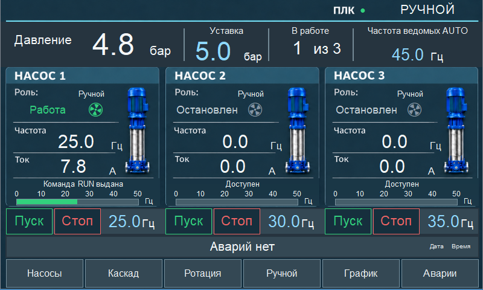
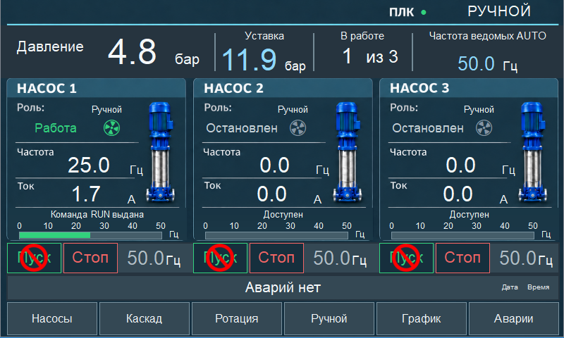
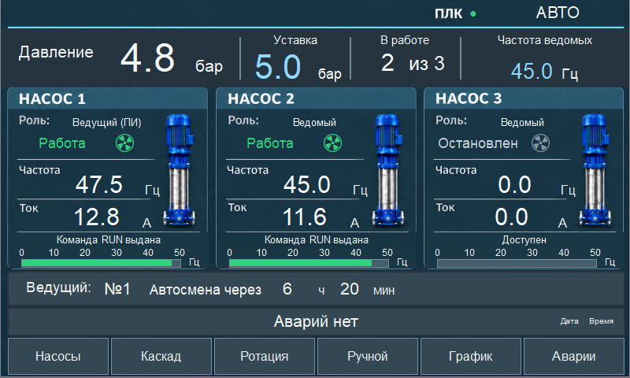
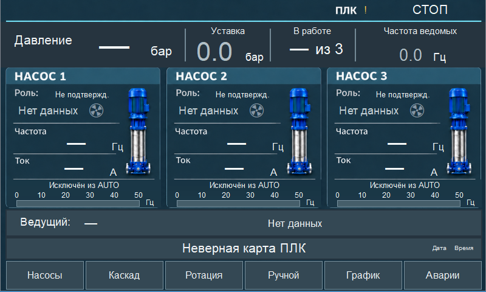

# Бабанов r21c — локальная native-проверка 24.11.2026

Главный экран доработан в отдельной r21c без повторного переноса Main. Среда: Windows, SKTOOL7.1 из `C:\Program Files (x86)\SKTOOL7.1`, SK-070HE, Offline Simulator 800×480. Поля версии exe пусты; номер версии из ресурсов не установлен. Проверенная Git-база: `750ee75a1db5f94926ddd13a6121028419b3b283`, рабочая ветка `codex/telemetry-r19-local-20261117`. Целевые рисунки и сравнение прочитаны из этой базы; они являются эскизами, а изображения ниже — настоящими снимками Simulator.

## Итоговый приватный native

```text
C:\Users\user\CodexProjects\pump-station\.worktrees\station002-fault-reset-local-15\_release_private\Бабанов_R21c_Main_2026-11-24\pump_station_3p_babanov_r21c_main_manual_native.skm
```

Размер: **1650072 байт**. SHA256: `9ba1a287f70df1167b2bc927b9d059d0b02372b147e6b083756c251e589fec0d`.

Исходная r21b сохранена: 1616335 байт, SHA256 `14533d71d69cb0d90bfb8ba361de4d608ded2987b14b9c5fa6c7e108ef362b4a`. Перед редактированием пользовательское окно штатно сохранено отдельно в `USER_WINDOW_SNAPSHOT.skm` рядом с r21c: 1616224 байт, SHA256 `d14a9425e650daf88a18237bac448162db54d6cfd09ada8aa3a9d1c922fd5ba0`. Все 622 набора свойств, 616 доступных геометрий и production C совпали с базой; байтовое отличие относится к native-кешу. Более новые настройки в буфере не обнаружены, буфер сохранён.

## Изменения

- Шесть исходных Пуск/Стоп: зелёные/красные надписи и тонкие контуры, тёмные поверхности, Arial18, одинаковые 74×40 и зазор6. Адреса M380..382/M384..386, операции нажатия/отпускания и разрешения сохранены.
- Три ручные частоты: Arial22, единицы Arial15, одинаковые координаты относительно карточки. Голубой `8ED8FF` при доступном вводе, серый `B1BEC6` при запрете; единицы нейтральные. Нет индивидуальных заливок, рамок или bitmap-скина. 50.0 Гц помещается. Тип, точность, клавиатуры и пределы не менялись.
- Серые маски под статусами/шкалами заменены пассивной native-поверхностью из 30 небольших градиентных ячеек в палитре карточек. Она закрывает старые запечённые подписи/деления. Статусы и деления имеют по одному видимому слою. Исходный bitmap ST0 не изменён. Статусы используют прежние источники и подписи, Arial11; деления Arial10.
- У всех шкал видимая нейтральная пустая дорожка. Исходные BG10012/26/40 сохраняют адреса, диапазоны, зелёное заполнение и условия качества. При останове дорожка пустая, при неизвестности числовые показания остаются прочерками.
- В MANUAL возвращена подпись «Частота ведомых AUTO» через пассивный native-текст с прежним флагом режима LB1260. В AUTO остаётся «Частота ведомых».
- Верхние прозрачные поля r21b сохранены целиком: нижняя линия y99, зазор до карточек11px, число–единица15px, уставка крупнее ведомых. Индивидуальных подложек нет.

Production C в обоих зеркалах побайтово совпадает с r21b. Статический контроль: 594 неизменных набора свойств, 28 изменённых только по UI, 16 новых пассивных текстов; все 17 экранов и 7 групп аварий сохранены. Touch/write-guards, числовые типы/точность/пределы, действия отпускания, неизвестные состояния и переходы сохранены. PLC-файл не менялся (SHA256 `e163898006de80a0f88bc1f3b9d663860c4bc15c82dbc405cf73882e75276702`). Полные аудиты оставлены приватными.

## Проверки, выполненные агентом локально

| Проверка | Результат |
|---|---|
| SaveAs и независимое открытие с диска | PASS |
| Script Compile production, HMI/local | 0 ошибок / 0 предупреждений |
| Полный Compile HMI | «The project was compiled successfully» |
| Offline Simulator 800×480 | PASS |
| MANUAL: первый работает, второй/третий остановлены | Счётчик1, один зелёный вентилятор, две пустые дорожки |
| AUTO, СТОП, нет связи, неверная карта, contract/busy | Проверены локальными TEST_ONLY входами |
| Уставка /100 | 0.1 и11.9 бар, правильная клавиатура; 12 отклонено |
| Частота ведомых /10 | 20.0 и50.0 Гц; 19.9 отклонено |
| Ручные /10, все три поля | 10.0 и50.0 помещаются; клавиатуры открываются, 9.9 отклонено |
| Заблокированный ввод | Серые числа, клавиатура не открывается |
| Все шесть ручных кнопок | Локальные приёмники TEST_ONLY получили все шесть нажатий/отпусканий, маска63 |
| Busy: три запрещённых Пуск | Маска0; частоты не открывают клавиатуру. Стоп сохраняет своё исходное разрешение |
| Production после тестов | Повторно открыт с диска, тестовых объектов/подмен нет, SHA стабилен |

[Script Compile](station002-r21c/script-compile.png), [полный Compile](station002-r21c/whole-compile.png), [клавиатура уставки](station002-r21c/keyboard-setpoint.png), [ручная клавиатура](station002-r21c/keyboard-manual.png), [шесть локальных приёмников](station002-r21c/commands-all.png), [запрет Пуск](station002-r21c/commands-blocked.png). Дополнительные диагностические кадры содержат явно тестовую полосу: [нет связи](station002-r21c/no-link-test.png), [неверная карта](station002-r21c/wrong-map-test.png).

Синтетические входы и приёмники существуют только в отдельных TEST_ONLY SKM. Статусы, вентиляторы, шкалы и счётчик вычисляют настоящие PumpAnimation → MainOverview → MainManualPresentation из согласованных F/Q, без независимой подмены результата. Для чистых кадров диагностические элементы удалены из тестовой native-копии до её запуска; снимки не ретушировались. Все пять чистых копий с фиксированными входами прошли Script Compile 0/0.

После завершающего production Compile/Save native-кеш изменил хеш первого скомпилированного файла `8fc1f33610992ab3827ed0b19fb8d7a73408edaa2a18022b068b41ad5c031db0` на итоговый выше. Независимое сравнение всех пяти отснятых копий с итоговым production после нормализации только TEST_ONLY адресов подтвердило совпадение **638 наборов свойств, 632 геометрий, 67 пассивных прямоугольников** в каждом случае. Это подтверждение конфигурации, а не байтового равенства тестовых файлов. Затем итоговый production заново открыт с диска (PID12464) и запущен в Simulator; его снимок ниже сделан уже от итогового файла.

## Свежие реальные снимки 800×480

MANUAL, доступное управление, локальные TEST_ONLY входы:



MANUAL с блокировками. Голубые верхние поля сохраняют исходное разрешение; три ручных частоты серые, Пуск запрещён:



AUTO, согласованные TEST_ONLY входы, два работающих насоса:



Итоговый production после независимого открытия. Реальной связи нет: прочерки измерений, недостоверный счётчик, нет данных/неверная карта. Серые 0.0 — содержимое заблокированных полей настроек, не подмена измерений:



[Максимумы11.9/50.0](station002-r21c/manual-max.png) · [минимумы0.1/20.0/10.0](station002-r21c/manual-min.png).

## Ограничения и передача

Download не нажимался, оборудование команд не получало. PLC, SCADA, радио и БД не изменялись и их текущее состояние не переизмерялось. Физические приводы и аппаратные блокировки не проверены. Старые пользовательские окна r20/r21 и dirty-корень сохранены; итоговое production-окно и его Offline Simulator оставлены открытыми. Следующий шаг — пользовательская визуальная оценка r21c; новых полевых действий не назначено.

Первый диагностический сценарий из-за старого пути записал несколько временных PNG в приватную папку r21b. Исходный SKM и опубликованные r21b-доказательства не затронуты; доступные исторические PNG восстановлены из Git, остальные ранние кадры сохранены в r21c/early-captures с пояснением. Все опубликованные здесь финальные кадры сняты заново в корректную папку.

Native SKM, полные дампы, тестовые проекты и аудиты остаются приватными. Этот отчёт и снимки публикуются отдельным коммитом после проверенной базы750ee75; SHA публикации сообщается после push.
