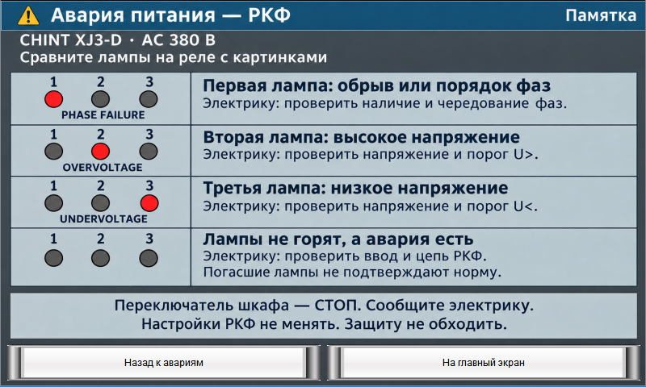

# РКФ: сохранённая r18a, Compile и Offline Simulator

Проверено локальным Codex 17.11.2026 МСК на Windows, в открытом SKTool.
SKTool: `-V7.1-054-build20240823` из установленного SKSoftwareVersion.ini;
заголовок SKM `SKTOOL-V7.1.0.80`, SK-070HE, 800×480, 17 страниц.
Проверенная документальная база: `2f2f7a75861de6098d6bdbbcafdcc27fccbfd2ba`.
Публикационный checkout: `codex/rkf-completion-20261117`, создан от этой базы;
исходный checkout `codex/project-handoff-2026-10-31` на `5e3cbae…` и его
накопленные изменения сохранены. SHA данного отчёта определяется следующим
коммитом документации и не подменяет проверенную базу.

## Фактический результат

```text
C:\Users\user\CodexProjects\pump-station\.worktrees\station002-fault-reset-local-15\_release_private\Бабанов_R18_РКФ_2026-11-16\pump_station_3p_babanov_r18a_rkf_help_native.skm
```

Размер: **1493506 байт**. SHA256:
`f09dd8243b032e964d325adef7337dfc10ba26ff762b81449b01fb96b0d353d5`.

Рядом в `assets/xj3-d-help-numbered-project.png` сохранён точный согласованный
PNG из 2f2f7a7: 1839841 байт, SHA256
`16fad2e7af534fb6e09de8131d69848025123ff7cc19a20d61ed5fee22b3ee78`.
SKM использует внешний файл рисунка: каталог assets рядом сохранять.
Исходные r18/r17a и принятый комплект PLC/ZIP не перезаписывались.
Промежуточные r18a без `_native` и r18b — история, итог указан выше.



## Что было в открытой r18 и что исправлено

В начале агент установил по настоящему заголовку PID6276, что открыта
`pump_station_3p_babanov_r18_rkf_help_native.skm`, страница «Памятка РКФ».
Она уже содержала старый сиреневый рисунок, две настоящие кнопки,
расширение AlarmSound для однократного события и PLC Control:
LB810→Screen7 и LB811→«Памятка РКФ», condition=1, Automatic Reset включён.
Нативный ID памятки — 3; это существующая 17-я страница, новая не создавалась.

Старый рисунок заменён именно согласованным серо-синим PNG, с заголовками
«Первая лампа», «Вторая лампа», «Третья лампа», номерами над кружками,
серым предупреждением без жёлтого баннера. Исправлены смещение/обрезка
картинки и геометрия настоящих кнопок: верх428, высота44, ширина388,
левые края8/404. Кнопки перекрывают графические кнопки без двойных надписей.
Добавлен ручной вход «РКФ: что делать?» в свободную часть заголовка журнала.

«Назад к авариям» первоначально фактически открывала Screen1. Нативный диалог
сохранял противоречивые поля маршрута 48=0/49=8/56=Screen9/57=0/60=8.
В отдельной r18b после Save исправлены только два байта полей48/57 на8;
родительская r18a сохранена. Затем файл нативно открыт, скомпилирован,
рисунок заменён и итог сохранён штатным Save As. Реальный возврат к журналу
и возврат на главный экран подтверждены Simulator, а не только полями.

## Проверки

| Проверка | Результат |
|---|---|
| Save As, сохранение и повторное File Open итогового SKM | PASS |
| Native Script Editor Compile AlarmSound, HMI и local | PASS: 0 errors, 0 warnings, Compile success |
| Финальный Offline Simulator, журнал→памятка, обе кнопки возврата | PASS |
| Вёрстка 800×480, правильный рисунок, без двойных кнопок | PASS; снимок выше |
| Два одинаковых source-макроса, структура directory/EOF, отсутствие probe | PASS |

Итоговый AlarmSound побайтно равен исходному макросу открытой r18, SHA256
его UTF-16BE source `75c887a8438984abb04cb30dc9f73406cc191ff461226f7c6ec3a5708cb6090f`.
Рисунок/геометрия/навигация не изменили Batch-контракты, сервисные команды
или сохранённый механизм ручного окна LB810.

Однократный автопоказ проверен отдельно в `TEST_ONLY_OFFLINE_RKF_EPISODES.skm`:
только в этой приватной копии перед штатным обработчиком подставлялись
синтетические AlarmWords[4]=32, LB60107=1 и R2550.0 с тремя интервалами
48..159,176..287,304..415 вызовов. Нативная компиляция probe прошла.
В Offline Simulator наблюдались автоматическое открытие, закрытие,
сохранение страницы журнала при активной аварии и последующее автоматическое
открытие после предусмотренных очистки/нового события. Таймер — число вызовов,
не точная длительность в секундах; точное число показов не заявляется.
Полные source-зеркала probe менялись с сохранением длины и обратимой сверкой.
Финальный SKM затем снова открыт, штатный макрос перекомпилирован;
`probe_tick` в нём отсутствует. Probe не предназначена для загрузки в панель.

Сохранённая логика реагирует на R2550.0 только при связи/версии32; вооружается
после достоверного inactive, игнорирует неизвестное качество для re-arm.
Это статическая проверка кода. Потеря/восстановление связи, несовпадение
карты и одновременная конкуренция LB810/LB811 отдельным runtime-сценарием
не проверены. Работа на реальной панели/реальная авария питания не проверены.

ПЛК/ПЧ/SCADA/радио не изменялись; Run/Force/download и полевых команд не было.
Диалог Online simulation Settings однажды был открыт при выборе toolbar;
закрыт через Quit без Run. Все описанные runtime-прогоны запускались через
Tools→off-line-Simulation. Итоговый Simulator оставлен на памятке r18a native.

Приватные подтверждения рядом с SKM: `compile-final-r18a-native.png`,
`simulator-final-r18a-800x480.png`, три `probe-*.png`, `final-verification.json`.
Native/probe/полные снимки рабочего стола и локальные helper-файлы не публикуются.
