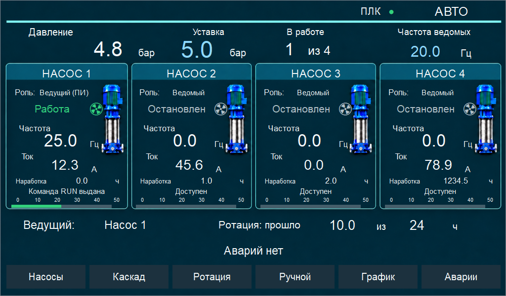
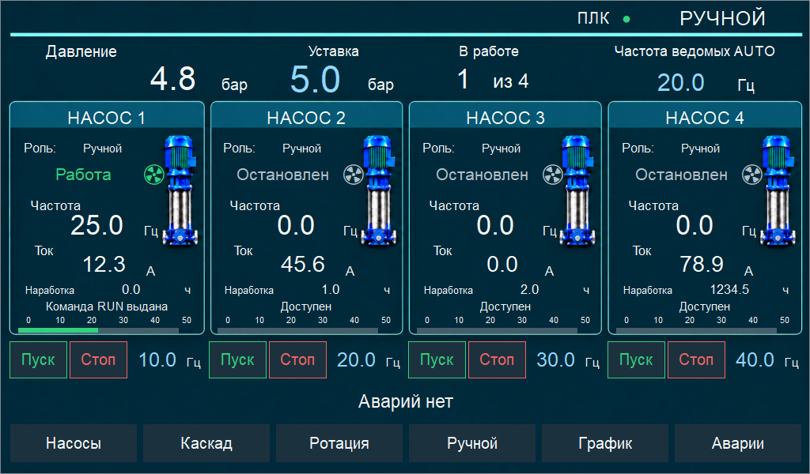
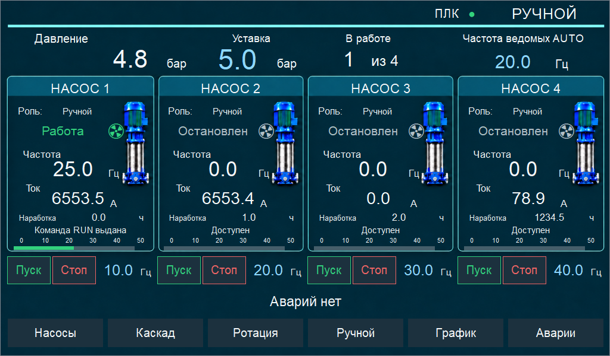
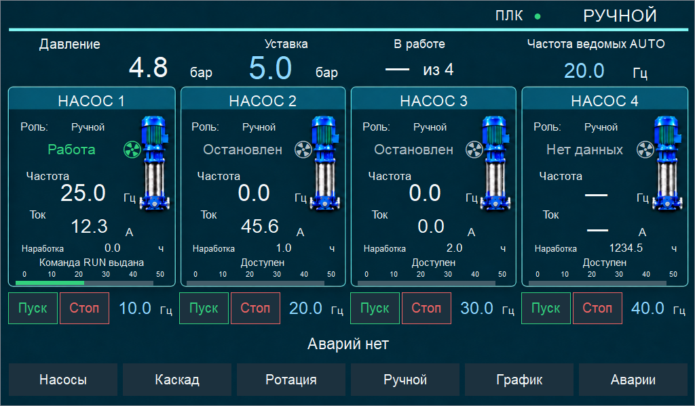
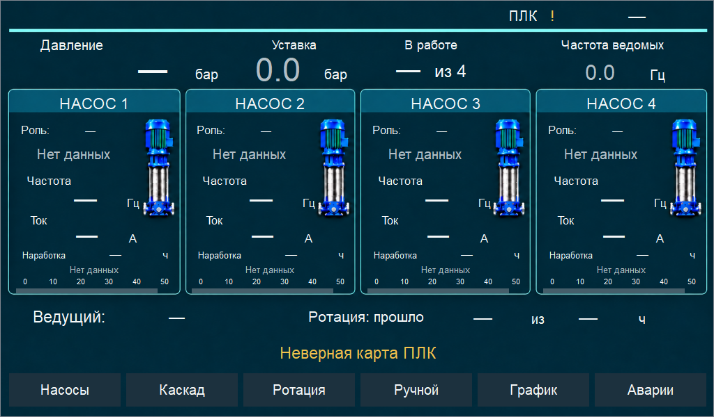

# «Ошский»: PLC/HMI telemetry r2 — локальный результат 25.11.2026

Windows, WinProLadder и SKTOOL7.1; 4 насоса, SCADA, SK-102CE 10″/1024×600.
Проверенная Git-база — `d4e29db6edad79a95a0c84615a2ac37860dc3ccc`, рабочая ветка
`codex/telemetry-r19-local-20261117`. Корневой checkout5e3cbae с прежним dirty
HANDOFF сохранён. Выполнено самим локальным Codex, без оборудования.

## Итоговые native-файлы

PLC:

```text
C:\Users\user\CodexProjects\pump-station\.worktrees\station002-fault-reset-local-15\_release_private\Ошский_R2_Телеметрия_2026-11-25\station_4p_oshsky_telemetry_r2_native.pdw
```

178518 байт; SHA256 `ecdc1abc4ea0cf3162a1757c86d0a9b1aa1ca9769f6093d92f874cb38bf9ca4a`.

HMI:

```text
C:\Users\user\CodexProjects\pump-station\.worktrees\station002-fault-reset-local-15\_release_private\Ошский_R2_Телеметрия_2026-11-25\pump_station_4p_oshsky_telemetry_r2_native.skm
```

1598612 байт; SHA256 `bab2a953f40c379e3cfc7f3bb5bf5f9bdd937b9841cb8e9e0598962e4691c089`.

Оба файла отдельные. Исходная05 и r1 сохранены; готовых r2 до начала не было.
Новый ZIP не создавался. PDW/SKM, C, полные дампы, TEST_ONLY и manifests приватны.
Шкаф отгружен; эти файлы **не загружались** в контроллер или панель.

## База и внешние потребители

При начале не обнаружено активных WinPro/SKTOOL моделей с пользовательским
буфером. Старые завершавшиеся процессы не сохранялись поверх файлов.
Просмотрены 103 PDW на Desktop и Documents/PLC; более новой четырёхнасосной
основы относительно проверенной05 не установлено. Свежие проекты иных объектов
сохранены. Рабочая база:
`C:\Users\user\Desktop\codex_plc_sp_feedback_01\station_MC_CM55_900G_05.pdw`,
178479 байт, SHA256 `6aba2a67d07596e4a479c462412859565186de86b410a3cd44476a81f20ffe81`.
HMI r1:1581363 байт/SHA256
`029111b555186d813ee212674cfc3442bb7f15fa649915a078f2da1a258a7f8d`.
Оригиналы скопированы в SOURCE_PRESERVED и повторно сверены.

Read-only проверены все 14 страниц/переменные HMI, 43 сохранённых OPC-профиля
с сохранением повторных JSON-членов и 11 Variables.svr SCADA. Ссылок на новые
R2504..2509/R3080 не найдено. Скрипты конфигураций не исполнялись, соединений
не было; существование профиля не объявляется его активностью.
Сборщик проверил прямые операнды, таблицы и блочные диапазоны фактической05;
11 BT_M/косвенные операнды дополнительно разобраны в принятом облачном отчёте
для того же SHA. В native проверена Element Statistics новых диапазонов
[R2500..2509](oshsky-telemetry-r2/native-r2500-allocation.png) и
[R3080](oshsky-telemetry-r2/native-r3080-allocation.png).

## PLC: сборка, native Save и F8

Штатный `tools/build_oshsky_telemetry_r2.py` создал отдельный candidate:
178597 байт/SHA256 `aec1a1c053681ea98f0ee26f5064e6a7bd808cc0835759461d1d7b4acdaabbda`.
`tools/validate_oshsky_telemetry_r2.py`:222 bytecode-сценария PASS.
16 сетей изменены,3 добавлены;1825 остальных побайтово сохранены.
1844 сети, карта32,9 таблиц/18 штатных строк,0 новых serial-запросов;
13680 байт свободно, watchdog5 секунд сохранён. Физические guards, команды,
режимы, каскад, уставки/обратные зеркала, ротация и RUN-счётчики не менялись.

F/I публикуются из одного принятого собственного семисловного снимка.
Ошибка инвалидации ограничена своей строкой FC03:0/3/16/17. Display-Q теперь
использует собственный cache; физические потребители M610..613 сохранены.
R2508 зеркалирует R2840, R2509=27401; R3080 — временный декодер строки.

WinProLadder: candidate F8, SaveAs native, закрытие/открытие сохранённого файла,
затем F8 заново. Модель в дереве FBs-32MC, проект PUMP_STATION_4.
**F8 native:0 ошибок /25 W85**. Отдельно открыта SOURCE_PRESERVED05:
тот же результат и полный список W85 в том же порядке.

В первой автоматизации старый файловый диалог дописывал путь, поэтому часть
промежуточных кадров не подтверждала reopening/F8. Эти кадры отвергнуты.
Повтор выполнен через адресное WM_SETTEXT только filename-поля диалога Open,
с точным readback полного пути и проверкой заголовка загруженной модели.
В отчёт включены только проверенные кадры [исходной05](oshsky-telemetry-r2/plc05-f8.png)
и [native r2](oshsky-telemetry-r2/plc-r2-f8.png).

W85 — Duplicated coil; ниже число предупреждений, не общее число инструкций:

| Катушка | OUTS | OUTR | OUT |
|---|---:|---:|---:|
| M1752 |1|2|0|
| M1753 |1|2|0|
| M1754 |2|2|0|
| M1755 |1|1|0|
| M330 |2|1|0|
| M331 |1|1|0|
| M1767 |1|0|0|
| M1768 |1|0|0|
| M1757 |0|0|1|
| M1421 |1|3|0|
| M1410 |0|1|0|

M1752..1755 — BOOT_CLEAR/создание/отмена/потребление pending-запросов;
M330/331 — arm/rearm режимов; M1767/1768 — reset/arm часов ожидания.
M1421 — boot/edit/new-leader/release/cancel/rearm часов ротации;
M1410 — boot-clear и потребление операторского запроса.
У M1757 действительно две OUT: PENDING_ANY до потребления событий и
PENDING_DISPLAY_ANY после него. Это существующая последовательная пересборка
признака; её не удаляли ради нулевого W85. Сети этих механизмов сохранены,
новых W85 нет. Это не объявление всех повторных OUT безопасными вне данного кода.

**Строгий validator над сырым native сначала отказал**, проверка не ослаблялась.
Разобраны отличия SaveAs: новый ключ шифрования image/data и обнуление 54 из59
сохранённых значений StatusPage0. Все59 адресов/строк/форматов остались прежними;
остальные5 значений уже были нулевыми. Декодированные image и data побайтово
равны candidate;9 таблиц и прочие non-PC metadata равны. В отдельной приватной
REVIEW_ONLY-копии нормализованы только ключ и эти проверенные display-cache
строки: неизменённый validator прошёл222 случая. Native-файл не нормализовался
и не подменялся review-копией. Он принят по явному сравнению + настоящему F8.

## HMI: четыре тока и живость

Новый Main не переносился. Добавлены4 read-only ND, изменены только4 условия
видимости прежних прочерков;655 прочих native-объектов сохранены.
14 страниц и настройки секций0..16 сохранены. Native Save также пересериализовал
порядок/автоматические имена20 пассивных Rect (полные записи после исключения
имени совпадают как multiset) и PNG-preview4 HT-графиков. У HT совпали все свойства
и все байты за пределами previewPNG. Привязки/геометрия/функции прочих страниц,
8 кнопок,4 ручных NE, пределы/клавиатуры/guards, наработка/scaling, LB810,
alarm/mute/BootAck/ретенция сохранены. Исходный C вне добавленной функции и её
единственного вызова совпадает после нормализации переводов строк.

Generated read-only `OshTelemetry`: Batch UInt16,28 байт,R2500..R2513.
`OshContract`:UInt16 read,R2329. В Variable settings сначала чтения, затем
прежний write BootAck; оригинальные AlarmWords/MapVersion/BootAck aliases
сохранены и генерируются SKTOOL, смещения pVar не задавались вручную.
Local LW54000..54005/LB2100..2103 проверены на отсутствие пересечения.

| Насос | Ток ×0.1 А | Собственное Q |
|---|---|---|
|1|R2504|R2510|
|2|R2505|R2511|
|3|R2506|R2512|
|4|R2507|R2513|

Белые прозрачные цифры Arial23, одна дробная, unsigned16 полностью сохранён.
0 →0.0 А;65535 →6553.5 А. Sentinel/искусственного предела нет.
Current допускается только при PLC link,Map32,contract27110,marker27401,
изменившемся R2508 и собственном Q1/2. После старта/invalid/reconnect первый
снимок только запоминается; retained-маркер или возврат link сами по себе
цифры не разрешают. Повтор одного heartbeat возраст не сбрасывает.

Возраст считается по существующей BCD RTC-секунде LW60000, а не по числу
нажатий/смен страниц. При age≥3 сек данные инвалидируются;65535→0 — движение.
В настоящем Simulator между elapsed4/calls7 и elapsed77/calls100 прошло
73 секунды и93 вызова: средний интервал около0.785 секунды. Поэтому проверка
возраста выполняется примерно каждые0.8 сек с секундной дискретностью RTC,
а не обещает таймер ровно3000мс. Физический опрос Port3/HMI на объекте не измерялся.
F/состояния/ротор/шкалы по своим прежним Q от нового current-маркера не зависят;
наработка от F/Q/current не зависит.

## Проверки Simulator

Script Compile production: **HMI0/0, local0/0**; полный Compile:
**The project was compiled successfully**. SaveAs, независимое открытие с диска,
затем финальное открытие production после TEST_ONLY — PASS. Финальный SHA повторён.

- AUTO/MANUAL:123/456/0/789 →12.3/45.6/0.0/78.9 А одновременно.
- Максимумы65535/65534 →6553.5/6553.4 А, без обрезки и наложения единиц.
- Q4=0: только F4/current4 неизвестны; остальные1..3 достоверны,
  наработка4=1234.5ч сохраняется, общий run-count неизвестен.
- Старый экспорт: неподвижный R2508 с retained marker27401 даёт прочерки;
  частоты/статусы и наработка продолжают прежнюю индикацию.
- Остановка heartbeat, возврат движения, потеря link, восстановление link без
  движения и последующий возврат heartbeat проверены в одном real-RTC прогоне.
- Неверная карта/отсутствующий marker/нет связи скрывают токи; старые guards сохранены.
- 65535→0 проверен реальными кадрами, токи достоверны по обе стороны перехода.
- Нажатие тока с максимумом не открывает клавиатуру. Новых командных объектов нет.
- Отдельный executable тест именно production-функции на локальных массивах:
  prime/reconnect/age3/ownQ/wrap/maxUInt16/map/contract PASS,100 повторных вызовов
  не освежают данные,120 секунд старого retained-экспорта остаются invalid.

Синтетика и приёмники только TEST_ONLY. Две ошибки диагностического harness
(перезапись CASE1 промежуточным файлом и пересечение diagnostic4900/4901 с
локальным receiver) устранены только в тесте; окончательные кадры временного
прогона используют4902/4903. Production detector при этом не менялся.
Вверху timing-кадров: **фаза / elapsed seconds / heartbeat / age / macro calls**.
В production этих полей/подмен нет.

## Реальные кадры

Прямой захват1024×600, без консоли, ретуши или генерации. AUTO/MANUAL —
TEST_ONLY, не показания отгруженного шкафа.









Production с диска, без соединения/подмен:



[F8 исходной05](oshsky-telemetry-r2/plc05-f8.png) · [F8 native](oshsky-telemetry-r2/plc-r2-f8.png) ·
[Script Compile](oshsky-telemetry-r2/script-compile.png) · [полный Compile](oshsky-telemetry-r2/whole-compile.png).

[Живой heartbeat](oshsky-telemetry-r2/heartbeat-live.png) · [возраст1](oshsky-telemetry-r2/heartbeat-age1.png) ·
[истёк возраст](oshsky-telemetry-r2/heartbeat-stale.png) · [движение вернулось](oshsky-telemetry-r2/heartbeat-resumed.png) ·
[link lost](oshsky-telemetry-r2/link-lost.png) · [reconnect/prime](oshsky-telemetry-r2/reconnect-prime.png) ·
[reconnect без движения](oshsky-telemetry-r2/reconnect-held.png) · [после движения](oshsky-telemetry-r2/reconnect-resumed.png).

[Retained marker/неподвижный HB](oshsky-telemetry-r2/legacy-retained.png) ·
[откат во время работы](oshsky-telemetry-r2/rollback-retained.png) ·
[нет marker](oshsky-telemetry-r2/marker-absent.png) · [неверная карта](oshsky-telemetry-r2/wrong-map.png) ·
[HB65535](oshsky-telemetry-r2/wrap-before.png) · [HB0](oshsky-telemetry-r2/wrap-zero.png) ·
[read-only ток](oshsky-telemetry-r2/current-readonly.png) · [конец измерения периода](oshsky-telemetry-r2/timing-end.png).

## Сохранность и границы

322 защищённых файлов повторно совпали с исходными SHA:
PLC05/прочие пользовательские PDW/HMI, SCADA/OPC/конфигурации SQL/радио,
программа Бабанова и прежний утверждённый комплект. Перезапусков этих систем,
SQL/Apply/Force/RUN/Download и команд оборудованию не было. Новых архивов нет.
Native проекты/полные dumps/секреты не публикуются.

Аппаратные модель/прошивка900G, соответствиеU0-06 и масштаба0.1А фактическому
ПЧ, loaded-версия шкафа, реальный serial-период/качество и физический RUN-импульс
наработки не проверялись. Отдельный runtime-pair quality по-прежнему отсутствует
в прежней базе; r2 не выдаётся за ремонт этого прежнего ограничения.
Следующий шаг — оценка локальной r2. Загрузка/аппаратная приёмка не назначены.
