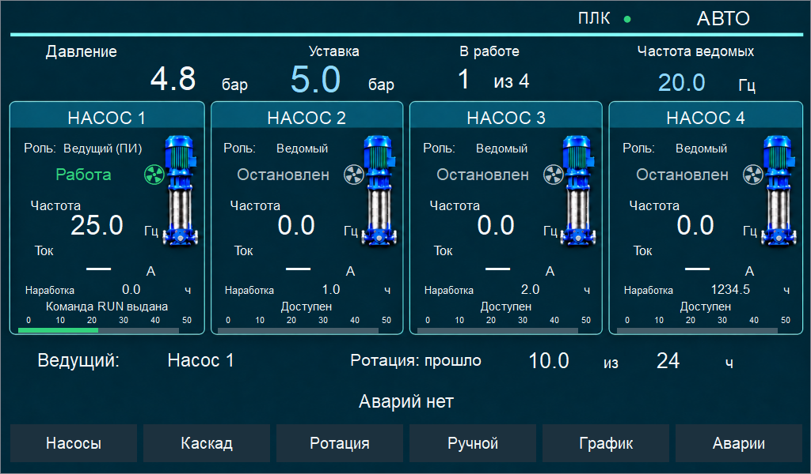
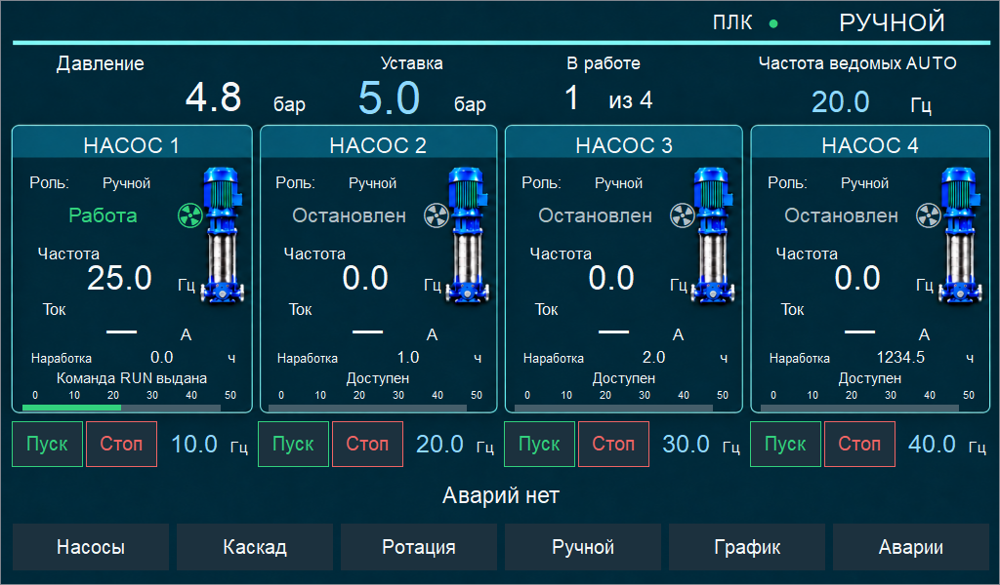
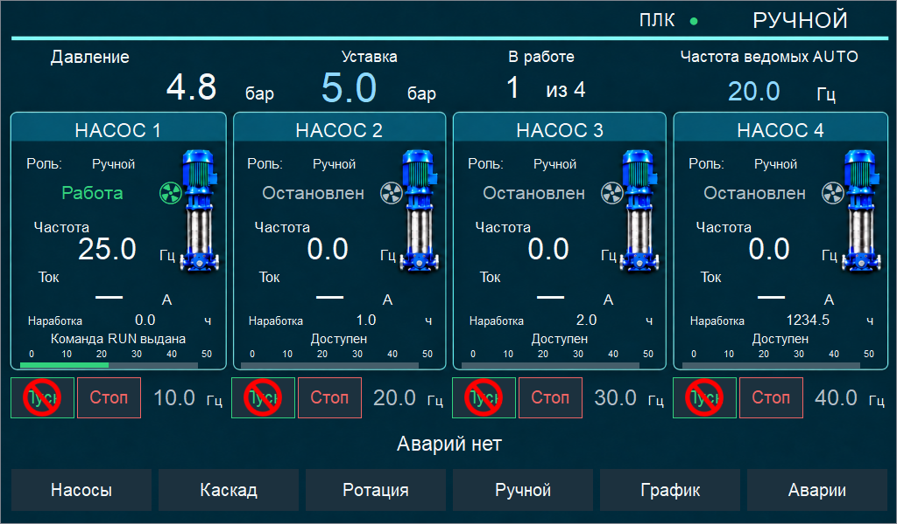
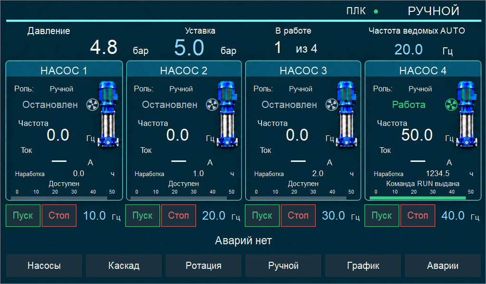
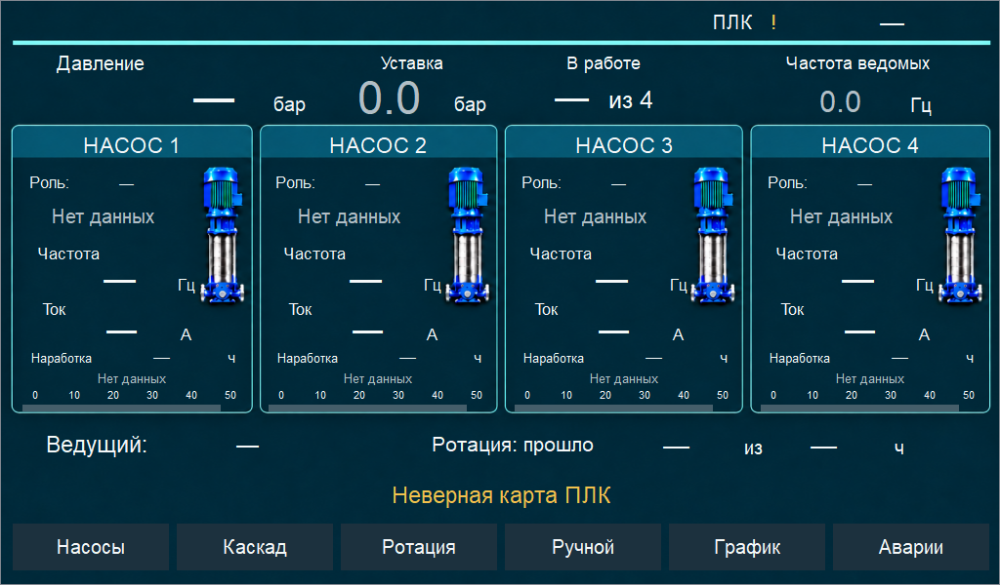

# «Ошский», 4 насоса: native Main r1 и наработка — 25.11.2026

Выполнено локальным Codex на Windows в SKTOOL7.1, SK-102CE/10″/1024×600.
Приняты задания910101e и cd00f06181dec74cee495254ba652f889b33d6c9;
затем уточнение имени/отгрузки f0db046f5b8e61f890e86c4d08c6356701016bfd.
Проверенная Git-база документации: `f0db046f5b8e61f890e86c4d08c6356701016bfd`, ветка
`codex/telemetry-r19-local-20261117`. Корневой checkout5e3cbae с чужим HANDOFF
сохранён. Утверждённый трёхнасосный Бабанов r21c и его PLC pins не изменены.

## Сохранённый результат

```text
C:\Users\user\CodexProjects\pump-station\.worktrees\station002-fault-reset-local-15\_release_private\Станция_4насоса_Main_R1_2026-11-24\pump_station_4p_scada_main_r1_native.skm
```

**1581363 байт**, SHA256 `029111b555186d813ee212674cfc3442bb7f15fa649915a078f2da1a258a7f8d`.

Отдельная r1, ранее выданной готовой четырёхнасосной r1 на диске не обнаружено.
SaveAs выполнен штатно; после доработок файл независимо открывался с диска.
Native/экспорты C/полные аудит-дампы и TEST_ONLY проекты остаются приватными.
Новых ZIP/комплектов для4насосов не создавалось.

Шкаф уже отгружен — это сообщение пользователя из f0db046. **Эта r1 в шкаф
не загружалась.** Фактическая версия внутри шкафа и работа связи заново не
измерялись. Все результаты ниже относятся к дисковым файлам и Offline Simulator.

## Выбор базы и контракт32

При начале работы открытой SKTOOL/несохранённого HMI-буфера не обнаружено.
Сохранённой новой четырёхнасосной Main-r1 не было. Проверены локальные HMI:

- Desktop/Pump_MC_CL50S_02/pump_station_4_37.skm совпал с архивом:
  SK-102CE/1024×600,14страниц,1321227байт,
  SHA256 `13cc9f7d1c5fa59d25c0eb871a2deb3e6f1ef6ca5079be2f5828df5f9e8f5867`.
- Более свежий `Documents/HMI/Samkoon/Насоска HMI/ошский.skm`:
  SK-102CE/1024×600,1321223байт,
  SHA256 `dffd9a6af3122827a615cb75cb148d03a8f98dedba00cdcd8378389b66e59b2f`.
  Все531 набора свойств,531 доступный geometry/painter prefix и оба C-зеркала
  совпали с4_37. Сохранена отдельная исходная копия; текущий уже собранный Main
  перенесён в её native-метаданные без повторной сборки экрана. Прочие байты
  новой базы сохранены вне согласованных UI/C/маршрутных правок.
- Более новые unified draft/layout имеют SK-070HE/800×480; сохранены отдельно,
  не подменяют согласованную десятидюймовую базу.

Четырёхнасосная PLC-база с диска:

```text
C:\Users\user\Desktop\codex_plc_sp_feedback_01\station_MC_CM55_900G_05.pdw
```

178479 байт, SHA256 `6aba2a67d07596e4a479c462412859565186de86b410a3cd44476a81f20ffe81`. Сравнение с04/SHA
`a25f9b5d2fe006bcb039896bae3989569b08e1b1adc4b503a755bfd5e3b22993`:
**все1834 общие сети в исходном порядке побайтово одинаковы**;05 добавляет
только7 зеркал подтверждения уставки. Обе публикуют32 вR2554: фактическая
инструкция95.W032 содержит MOV32→R2554. Это чтение native PDW, не readback ПЛК.

Сохранённые SCADA11 Variables.svr и MasterOPC-профиль прочитаны без исполнения
скриптов/соединения. Подтверждены `MapVersion→2554 uint16 ReadOnly`,
`PressureSP_x100→2360 uint16 ReadOnly`, `PressureSP_Command→2100 uint16 ReadWrite`.
В SCADA внутренняя числовая переменная принимает raw без дополнительного
скейлинга. StationID/OPC-prefix не переименовывались.

По этой сверке в HMI изменены только сравнения MapVersion31→32, комментарии
контракта и добавлен read-only флаг представления LB2000 из существующего
AlarmWords[2]. Алгоритм alarm/mute/BootAck/ретенции сохранён. Диагностическая
ревизия HMI LW820=31 остаётся31 — это отдельное поле, не карта PLC.
Настройки/variable-table секций0..16 побайтово совпадают с базой, ABI не расширен.
Трёхнасосный макрос/PLC не применялись.

| Данные | Реальные источники | Формат/разрешение |
|---|---|---|
| Уставка | R2100, зеркало SCADA R2360 | /100, исходная клавиатура/пределы0.1..11.9бар |
| Общая частота AUTO | R2110 | /10, исходные20..50Гц |
| Режим / MANUAL | R2300 / packed R2552 | Индикация; переключателя режима в HMI нет |
| F четырёх ПЧ | R2500..R2503 | /10; собственные Q=R2510..R2513 |
| Роль / PLC-команда | R2324..R2327 / R2320..R2323 | Оригинальные таблицы состояний |
| Пуск | M380..M383 | Клоны BB9028/56/84/9112, touch M1530..M1533 |
| Стоп | M384..M387 | Клоны BB9032/60/88/9116, прежний touch по связи |
| Ручные частоты | R2180..R2183 | NE9018/9046/9074/9102, /10,10..50Гц, touch M1534 |
| Контракт / связь | R2329=27110 / LB60107 | Сохранены; новый Main также требует карту32 |
| Наработка | R2200/1,2202/3,2204/5,2206/7 | Исходные32-bit unsigned, минуты команды RUN→часы |
| Ротация | R2151/2 и R2140/1 | Существующие PLC-минуты: прошло/интервал в часах, без HMI-таймера |
| Ток каждого ПЧ | Не предоставлен сверенной картой32 | Честный прочерк; I из fixed-three не заимствован |

Оригинальный Text5234 четырёхнасосной диагностики также прямо указывает,
что токи появятся после добавления их опроса в ПЛК. Такой PLC-этап здесь не делался.

## Native UI

Чистый предоставленный фон используется как StaticPicture1024×600;
подписи/значения/состояния/контролы — настоящие native-объекты. Четыре равные
карточки доy422, наработкаy356, статусы/шкалы ниже; ручной ряд430..478,
аварии486..528, навигация536..584. Размеры основных показаний и кнопок сохранены.

Пуск/Стоп70×44: зелёные/красные подписи, тонкие контуры, тёмная поверхность.
Функция **Invert / Press execute**, адреса, операции отпускания, notification
и исходные touch-guards скопированы целиком. Восемь контролов проверены
отдельно, четвёртый канал не выведен предположением из третьего.
Четыре NE сохраняют тип/точность/пределы/клавиатуры. При запрете NE скрыт,
виден прозрачный серый ND; синхронизирован в том числе M1534.

Уставка крупнее общей частоты: native Arial38 против25. Ручные числа Arial20
(около24px), единицы12, кнопки16. Активные числа8ED8FF, запретB1BEC6,
показанияF4F7F8; без числовых подложек/рамок/bitmap. Ротор — исходный шрифт
Pump Station Rotor, зелёный только по собственному Q2; останов/unknown серые.
Нейтральная пустая дорожка видна при останове и отсутствии данных.

При MANUAL подпись «Частота ведомых AUTO». В других режимах видны фактический
ведущий и прогресс PLC-ротации (прошло/интервал); нового отсчёта HMI нет.
LB810 ведёт на Main/Screen1, Condition1 и Automatic Reset сохранены;
one-shot/rearm исходного PanelHelpers не менялись. Ручная страница остаётся
в меню. Шесть переходов сохраняют реальные IDs:6/2/3/7/8/9, диагностика доступна
с прочих страниц. Все14страниц сохранены. На2..13 изменены только фон и179
нейтральных подписей; формы, графики, alarm-таблицы, сигнальные цвета и LOGO14
сохранены.269 наборов свойств остальных страниц неизменны,4 изменены только
для перевода наработки,179 — только по цвету обычного текста.

## Наработка и установленная ошибка исходного ND

Каждая строка — read-only ND из страницы «Насосы»: ND14004/08/12/16.
Тип **32-Bit Unsigned Int / 32-Bit Unsigned Decimal**, порядок слов и исходные
коммуникационные настройки сохранены. Одна дробная цифра, белый текст,
прозрачность; клавиатуры/сброса нет. Строки видны в AUTO/MANUAL/СТОП.
Качество не зависит от F/Q своего ПЧ и busy/M1534.

Первый реальный Simulator показал60→6.0 и74070→7407.0. Native Advanced выявил
**Scaling выключен**: записанная в legacy поле33 строка0.1666 не является
активным преобразованием. В Native UI подтверждено: enable — поле20,
рабочий gain —21. Включены Scaling/gain1/6 при прежней1 дробной цифре:
видимое значение = raw_minutes/60. Исправлены те же четыре ND страницы
«Насосы», чтобы она совпадала с Main. Ни счётчики, ни PLC-минутный импульс
не изменялись; физический период импульса не измерялся.

Отключение связи обнаружило аналогичное отличие двух слоёв уставки:
NE показывал5.0, серый ND —50.0. Исправлен только read-only gain ND0.1
при прежнем формате; теперь оба слоя дают /100. Тип/точность/пределы NE сохранены.
Вместо пустых полей при PLC-invalid добавлены эксклюзивные native-прочерки
режима/ролей/сводки; тестовых подмен в production нет.

| Сырые минуты | Native часы Main = «Насосы» |
|---:|---:|
| 0 | 0.0 |
| 60 | 1.0 |
| 120 | 2.0 |
| 74070 | 1234.5 |
| 65535 | 1092.2 |
| 65536 | 1092.3 |
| 2147483648 | 35791394.1 |
| 4294967295 | 71582788.2 |

Это наблюдаемое native-округление с1дробной, в том числе на половинных значениях.
High-word не теряется, signed overflow/обрезки нет. Наибольшее число помещается
в114px и не заходит на «ч». Достоверный0 отображается0.0; при PLC link/map/
contract-invalid — «— ч». При Q4unknown, но валидном PLC-counter4,1234.5ч остаётся.

**Граница доказательства:** отдельного quality-флага чтения каждой пары
R2200..R2207 фактическая база не экспортирует. Офлайн проверены общие PLC
link/map/contract и независимость от VFD-Q. Изолированный сбой одной пары
при продолжающейся GOOD-связи с остальными регистрами отдельно не подтверждён;
нового выдуманного PLC quality-адреса не вводилось.

## Выполненные проверки

| Проверка | Результат |
|---|---|
| Native SaveAs, независимое открытие с диска | PASS |
| Script Compile production HMI/local | 0 ошибок / 0 предупреждений |
| Полный HMI Compile | The project was compiled successfully |
| Offline Simulator | 1024×600, настоящий клиентский кадр |
| AUTO / MANUAL / СТОП | Наработка во всех трёх режимах; вСТОП счётчик0/4 и пустые дорожки |
| Первый работает, остальные остановлены | Согласованные F/Q, счётчик1/4 |
| Работает только четвёртый | Только четвёртый зелёный/50.0Гц; остальные0.0, счётчик1/4 |
| Только ПЧ4unknown | F4—, серый ротор, общий счётчик—; counter4=1234.5ч |
| PLC link / map31 / contract-invalid | Измерения и наработка—; запреты сохранены |
| Минимумы / максимумы | Уставка0.1/11.9, AUTO20/50, все ручные10/50; помещаются |
| Четыре ввода |12.3/50.0/10.0/45.6 только в свои локальные цели; ни одного Пуск |
| Клавиатуры / запрет |9.9Гц отклонено; серые поля/наработка не открывают клавиатуру |
| Восемь Пуск/Стоп | По одному запросу в каждый локальный приёмник; seen255, после приёма0, восемь счётчиков1 |
| Запрещённые Пуск | Все четыре нажатия дали0 запросов; Stop сохранил свою доступность |
| Повторное production-open после TEST | Отдельно с диска, без TEST_ONLY, SHA повторно проверен |

Исходная кнопка Invert/Press оставляет запрос до потребления PLC. Первый
TEST-монитор без потребителя накапливал ON-биты; это не ремонтировалось сменой
операции production. В TEST_ONLY добавлен локальный приёмник, фиксирующий
и снимающий каждый запрос. После нажатий/отпусканий ровно1событие на каждый
из8адресов. Изменения частот отдельно проверены до кнопок при нулевых приёмниках.

Все синтетические входы/приёмники только в отдельных TEST_ONLY SKM,
не в production. F/статус/ротор/шкала/число работающих читают одни и те же
исходные Q, независимой подмены состояния/вентилятора/счётчика нет.
Аудит подтвердил неизменность функциональных свойств8BB/4NE и секций0..16.
Сохранены SHA92 первоначально защищённых PLC/SCADA-файлов и3 инфраструктурных
конфигураций. Дополнительные снимки18 OPC-профилей и32 конфигураций
InSAT/радио/MySQL сняты перед заключительной серией и повторно сверены после неё.
Полные списки/хеши приватны; первоначальный и дополнительный этапы не смешиваются.
SCADA/OPC/БД/радио не перезапускались и не изменялись; новых SQL/Apply/Force/RUN/
Download/записей оборудованию0. Состояние аппаратуры/радио/архивирования
заново не измерялось. Упаковка отложена.

## Реальные кадры

Все PNG Simulator ниже — прямой захват клиентской области1024×600, без консоли,
ретуши и генератора. Это локальные TEST_ONLY входы; они не являются показаниями
отгруженного шкафа. Эскизы изdocs/ui/assets не выдаются за native-доказательства.

AUTO:



MANUAL:



Блокировки M1530..33/M1534, наработка сохраняется:



Только четвёртый работает:



Production после независимого reopening, без тестов/связи:



[32-битные максимумы](station4-scada-main-r1/manual-max.png) ·
[минимумы](station4-scada-main-r1/manual-min.png) ·
[СТОП](station4-scada-main-r1/stop.png) ·
[Q4unknown/counter4valid](station4-scada-main-r1/unknown-fourth.png) ·
[нет связи](station4-scada-main-r1/no-link.png) ·
[неверная карта](station4-scada-main-r1/wrong-map.png) ·
[запрет + максимумы](station4-scada-main-r1/blocked-max.png).

[«Насосы»0/1/2/1234.5](station4-scada-main-r1/runtime-pumps-page.png) ·
[«Насосы», большие32бит](station4-scada-main-r1/runtime-max-pumps-page.png) ·
[типND32bit](station4-scada-main-r1/native-uint32.png) ·
[исходный Scaling off](station4-scada-main-r1/native-scaling-off.png) ·
[маршрутLB810](station4-scada-main-r1/native-route.png) ·
[Script Compile](station4-scada-main-r1/script-compile.png) ·
[полный Compile](station4-scada-main-r1/whole-compile.png).

Диагностические TEST_ONLY-кадры имеют числовые приёмники сверху — они
отсутствуют в production: [8приёмников](station4-scada-main-r1/local-command-receivers.png),
[запрещённые Пуск](station4-scada-main-r1/blocked-local-receivers.png),
[4независимых ввода](station4-scada-main-r1/four-frequency-writes.png).
Дополнительно: [9.9отклонено](station4-scada-main-r1/below-min-rejected.png),
[серый ввод](station4-scada-main-r1/blocked-no-keyboard.png),
[наработка read-only](station4-scada-main-r1/runtime-readonly.png).

Далее — визуальная оценка локальной r1. Аппаратная приёмка, токи четырёх ПЧ
и отдельный сценарий ошибки чтения одной runtime-пары этим отчётом не закрыты.
