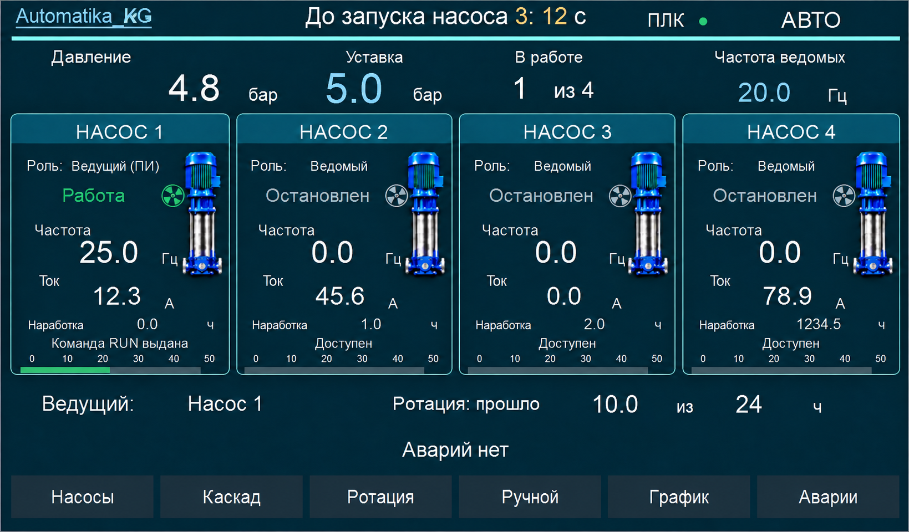
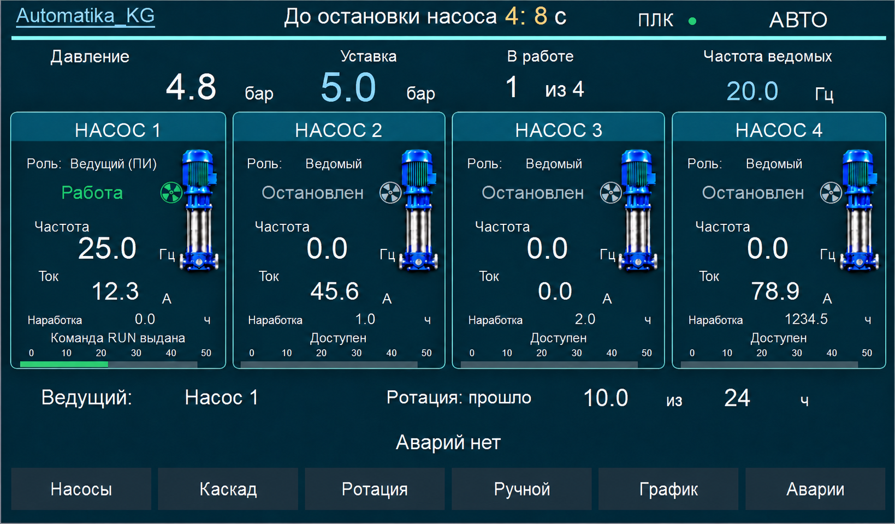
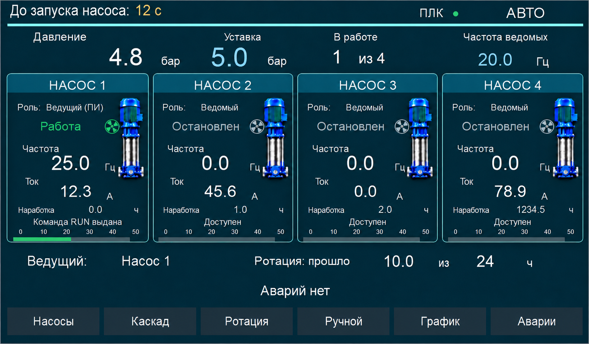
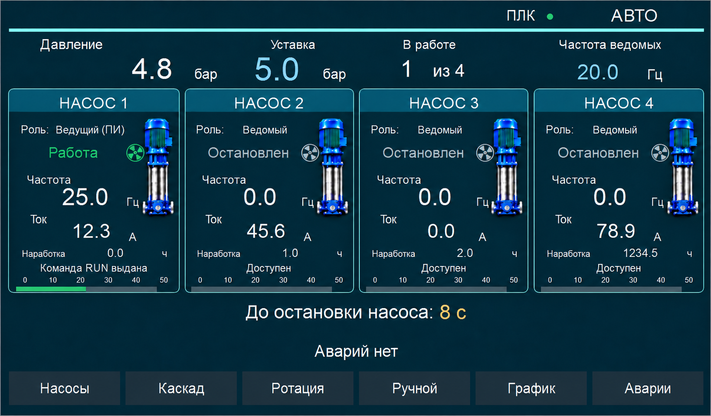

# «Ошский»: где показать ожидание пуска/снятия насоса

25.11.2026. Пользователь просит повторить независимые задержки «Бабанова»
для третьей/четвёртой ступени четырёхнасосного проекта и вывести на Main
обратный отсчёт пуска и остановки только во время ожидания.
Прямое ограничение текущего шага: «сначала покажи где можем расположить».

Подготовлены два эскиза из фактического AUTO Main native r2b/1024×600,
SK-102CE10″. Исходник — TEST_ONLY кадр, а не показания шкафа. Эскизы
сгенерированы image_gen, исходные PNG сохранены без ретуши/перемасштабирования;
размеры/SHA и исходник в [manifest](assets/oshsky-countdown-preview/manifest.json).
Это предложение расположения, не native Save/Compile или PLC-проверка.
Проект, параметры и таймеры этим шагом не менялись.

## Текущее решение после уточнения пользователя

Пользователь выбрал верхнюю строку, уточнив: левый угол отдать под надпись
«Automatika_KG» с переходом на карточку логотипа, отсчёт разместить по центру
и добавить номер насоса. Это заменяет первоначальную рекомендацию A.

- Слева постоянно видна кликабельная «Automatika_KG», ориентир
  x16,y4,w184,h34. Светло-голубой текст с лёгким подчёркиванием, без большой
  картинки в шапке. Нажатие ведёт на существующую Screen14 с восстановленным
  оригинальным JPEG. На карточке нужен понятный возврат на Main; это новое
  разрешённое пользователем расширение прежней production-навигации.
- Центр верхней строки: ориентир x308,y4,w408,h34, около22px. Сообщения:
  «До запуска насоса 3: 12 с» / «До остановки насоса 4: 8 с».
  Номер и секунды янтарные, пояснение белое, подложка прозрачная.
  Номер — реальный ожидаемый насос по данным ПЛК, не номер ступени.
- Справа остаются прежние ПЛК/режим. Нет активного ожидания — центр пустой,
  бренд остаётся видимым. Карточки, ведущий/ротация, ручные кнопки, аварии
  и footer не сдвигаются. Startup/Load LOGO/saver от перехода бренда не меняются.

Новые картинки — эскизы размещения на том же условном TEST_ONLY фоне,
не модель совпадения частоты/тока/числа работающих с конкретной задержкой.
Изображения не являются native-проверкой команды или обратного отсчёта.

## Ранее показанный A — свободная верхняя строка слева

Ориентир native-области: x20,y4,w680,h34, перед существующими «ПЛК»/режимом,
выше бирюзовой линии. Надпись около24px, секунды тёплым янтарным#F5D27A,
подпись белая, фон прозрачный. Это индикация, не поле ввода.

Два состояния одной области: «До запуска насоса: 12 с» и
«До остановки насоса: 8 с». Нет активного ожидания — область пустая.
Ведущий/ротация, карточки/показания/наработка, ручной ряд, аварии и footer
остаются на месте. Этот вариант сохранён как история первоначального выбора.

## Ранее показанный B — временно вместо сводки ведущего/ротации

Ориентир: x12,y430,w1000,h48, около26px. При активном штатном AUTO-ожидании
в этой строке отображается пуск или остановка. Когда ожидание завершено/
отменено, возвращаются прежние ведущий и ротация. В MANUAL остаются
четыре группы Пуск/Стоп/частота; область ими не перекрывается.
Строка аварий не используется под таймер и остаётся видимой.

Различающиеся пуск/остановка на двух картинках иллюстрируют обе формулировки;
каждое из двух мест поддерживает оба сообщения. Показания и значения секунд
условные, картинки не моделируют процесс или одновременность каскадных событий.

## Источник поведения и что предстоит сверить

Прочитаны [история r10 Бабанова](../reports/station002-cascade-r10-20261109.md)
и `tools/build_cascade_r10.py`: первая задержка R2123/D910 для подключения
первого ведомого, следующая независимая R2885/R2896 для второго ведомого.
Ожидание второй ступени начинается заново, не наследует первый счётчик;
сравнение «следующая задержка должна быть больше» пользователь отменял.
Это очередность подключения, а не закрепление за физическими номерами:
при ротации ведущий и последовательность меняются.

Для «Ошского» запрос соответствует добавлению независимых выдержек выхода
на3и4работающих насоса рядом с прежней выдержкой выхода на2. Нельзя переносить
весь fixed-three PLC или номера регистров без проверки актуальной r2.
Объём отдельных настроек снятия и начальные значения новых задержек ещё
не установлен текущим preview-шагом; явно требуется индикация остановки.
До изменения логики сопоставить это с actual4-насосным каскадом.

Владельцем remaining/active/action служит настоящий PLC-таймер. HMI только
показывает остаток при достоверном активном ожидании. Локальный отсчёт по
макроциклам не заменяет PLC. Завершение/отмена, уход из AUTO и недостоверные
PLC-данные скрывают надпись. Не задерживать аварийный/быстрый останов ради
отсчёта; существующие защиты и приоритеты сохраняются.

Требование номера насоса добавлено последующим уточнением: перед реализацией
проверить actual-порядок выбора кандидата на пуск/снятие в четырёхнасосном
ПЛК. Индекс нельзя угадать из номера выдержки или всегда показывать3/4 при
ротации. Источник достоверного pending-индекса и его согласованность с таймером
должны быть установлены по исходникам; новые адреса сейчас не назначены.

Расположение выбрано пользователем: бренд слева, отсчёт по центру.
Сейчас выполнен запрошенный предварительный показ. Изменение PLC/HMI,
native Compile/Simulator и загрузка оборудования не выполнялись.
