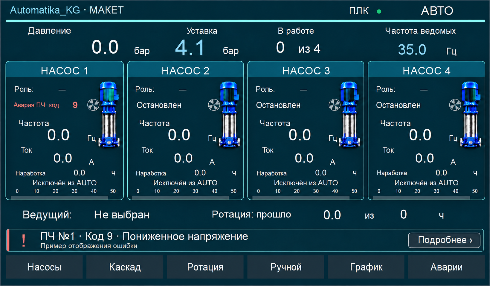

# Ошский: макет отдельной строки ошибки ПЧ

27 ноября 2026, МСК. Пользователь просит реальный код с описанием и отдельный
блок на Main. На предложение поставить его над нижним меню ответил:
«Сначала покажи макет». Размещение ещё не утверждено.

Макет создан imagegen по реальному кадру текущей четырёхнасосной HMI:
[исходный кадр Simulator TEST_ONLY](../reports/oshsky-live-native-20261127/four-main.png).
Это иллюстрация для выбора места, не native-фон для загрузки и не измерение
стенда. Область над переходами заменяет общую надпись «Есть авария»:
номер ПЧ, числовой код, описание и отдельный переход «Подробнее».
Верхний центр сохраняется под active countdown. Карточки и нижние переходы
используют прежний стиль. На макете показан AUTO; в native отдельно проверить
соседство с ручными органами MANUAL и существующими касаниями.

Код9/«Пониженное напряжение» и остальные значения — пример отображения,
не новое подтверждение ошибки или словаря M900G. Описание брать из
проверенного руководства конкретного ПЧ. Для неизвестного кода показывать
число. При нескольких ошибках нужен доступ к каждой, а не потеря остальных
сообщений. Размеры/перенос длинного текста/target «Подробнее» проверить
в настоящем SKTOOL1024×600 после выбора места. Отдельный layout native
пока не менять; существующий показ/обмен можно исправлять независимо.

В Cloud прочитаны DESIGN.md и фактические Main-кадры; проверен вид макета,
читаемость номера/кода/описания, отсутствие наложения на навигацию. Нажатия,
реальные данные, полный набор состояний и native Compile этим не проверены.
Продолжение — [раздел3 текущего задания](../tasks/oshsky-live-pump1-data-and-native-fault-local-20261127.md).
