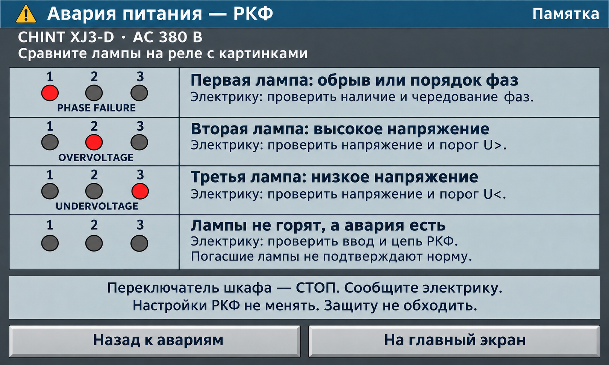

# Памятка РКФ: CHINT XJ3-D AC 380 В

16.11.2026. Пользователь сообщил модель: **CHINT XJ3-D AC 380**.
Задача: при сообщении «Авария питания» дать оператору картинки ламп,
их значение и понятные действия. Это дополнение к HMI комплекта «Бабанов».

## Подтверждённые значения

Заводское англоязычное руководство **2111-XJ3-D**, документ
**0ZTT.463.032.EN**: PDF-страница 5 (печатная 03), §2.1.1–2.1.4;
PDF-страница 8 (печатная 06), Figure 5 и примечание;
PDF-страница 9 (печатная 07), Table 5.

[Руководство CHINT](https://www.chintglobal.com/content/dam/chint/global/product-center/low-voltage/iec/industrial-control/phase-failure-and-phase-sequence-protective-relay/xj3-d/manual/2111-XJ3-D-Phase%20Failure%20and%20Phase%20Sequence%20Protective%20Relay-Manual.pdf).
Получено с сайта производителя: 1542153 байта, SHA256
`adbd25a571c691f683e4a462d2bebf8b32c67ac46f4df372e165370522ae14d5`.
PDF отрисован; перечисленные страницы прочитаны визуально, OCR использован
как вспомогательная сверка. Сам vendor-PDF в Git не помещён.

| Что видит человек | Значение по руководству | Действие в памятке |
| --- | --- | --- |
| Первая лампа (1), PHASE FAILURE | Обрыв фазы или нарушение чередования фаз; эта лампа не отличает эти две причины | Сообщить электрику: проверить наличие и чередование фаз |
| Вторая лампа (2), OVERVOLTAGE | Повышенное напряжение относительно настройки реле | Сообщить электрику: проверить напряжение и порог U> |
| Третья лампа (3), UNDERVOLTAGE | Пониженное напряжение относительно настройки реле | Сообщить электрику: проверить напряжение и порог U< |
| Лампы погасли, сообщение об аварии остаётся | Погасшие лампы сами по себе не подтверждают исправность | Электрику: проверить ввод, питание реле, выходной контакт и цепь до ПЛК |

В примечании Figure 5 питание электроники реле указано от L1/L3;
при его потере лампы могут погаснуть, а разрешающий NO-контакт разомкнуться.
Это причина не подписывать картинку «все погасли» словом «норма».
L1/L2/L3 на корпусе — клеммы фаз, **не названия трёх ламп**.
Режимы мигания для отдельных причин в этом руководстве не заданы:
не придумывать их. При нескольких горящих лампах сообщить обо всех;
не задавать неподтверждённый приоритет причин.

Заводская Table 5 также перечисляет форму/частоту сети как возможную причину
PHASE FAILURE при внешне нормальном напряжении. Картинка определяет
направление проверки, а не окончательный диагноз измерением лампы.

Дополнительно сверены российские [карточка изделия, арт. 284003](https://ensmas.ru/catalog/oborudovanie_nizkogo_napryazheniya/oborudovanie_signalizatsii_i_upravleniya_/rele_kontrolya_faz/xj3_d/rele_kontrolya_faz_xj3_d_ac380v/)
и паспорт ver.03.2023. В коротком русском паспорте значения отдельных ламп
не приведены; источником их порядка служит Figure 5 английского руководства.

## Экран и действия

Ниже визуальный макет **памятки**, не снимок изменённого SKM или панели.

Последние уточнения пользователя: стиль главного экрана насосной и слова
**«Первая / Вторая / Третья лампа»** вместо «слева / в центре / справа».
Номера 1/2/3 стоят непосредственно над кружками. Старый сиреневый PNG с
жёлтым баннером устарел; добавление номерной строки поверх него не исправляет
оформление и оставляет прежние заголовки. Требуется замена самого рисунка.

- В «Аварии и история» сохранить обычную ручную кнопку **«РКФ: что делать?»**;
  она доступна также при просмотре истории и не подтверждает/не сбрасывает аварию.
- Дополнительно автоматически открывать памятку на новое активное событие
  B00 entry0 / R2550.0 один раз на эпизод. Памятку можно закрыть; пока бит
  активен, повторного auto-open нет. После очистки HMI re-arm разрешает новое
  открытие при следующем 0→1. Эта логика не управляет PLC и не анимирует лампы.
- Заголовок: «АВАРИЯ ПИТАНИЯ — РКФ», модель CHINT XJ3-D / AC 380 В.
  Подпись «ПАМЯТКА» и предложение сравнить реальные лампы с картинками.
- Четыре строки: первая / вторая / третья горящая лампа и все погасшие при
  наличии аварии. Номер/подпись дублируют цвет. Это статические примеры,
  их не подсвечивать автоматически от общего сигнала питания.
- Общая инструкция: «Переключатель шкафа — СТОП. Сообщите электрику».
  Следующая строка: «Настройки РКФ не менять. Защиту не обходить».
  Эти действия нужны оператору до работы специалиста.
- Измерения, проверка фазировки, контактов и настройки относятся к электрику.
  Памятка не предлагает оператору переставлять провода или вращать пороги.
- Две обычные кнопки возврата: «Назад к авариям», «На главный экран».
  Открытие, закрытие и просмотр картинки не записывают команды в ПЛК.

Статическая справка не требует новой программы ПЛК. В существующей проектной
документации X7 — общий исправный сигнал питания, X7=1 — исправное состояние
(`docs/tasks/station002-cabinet-bench-20261109.md`, строки 26/42).
Это не телеметрия отдельных ламп; фактическая проводка сейчас не измерялась.
R2526 — остаток паузы после питания, не причина срабатывания РКФ.
Существующие задержки, режим AUTO/STOP и автоматический перезапуск не менять.

## Визуальный договор для переноса

Экран SK-070HE, 800×480. Сохранить существующие шрифты и стиль native HMI;
палитра макета: стальной фон `#42494E`, синяя верхняя полоса `#284F68`,
светло-серые панели `#C4CDD2`, текст `#1D303D`, погасшие лампы тёмно-серые.
Нижняя инструкция на серой панели, обычные объёмные серые кнопки.
Читаемые надписи и три одинаково расположенных кружка с номерами в каждой строке.
Переходы — настоящие Screen Button из SKTool, высота области нажатия
не менее 44 px; изображение кнопки само по себе переходом не считается.

PNG-макет: 1620×971, 1839841 байт, SHA256
`16fad2e7af534fb6e09de8131d69848025123ff7cc19a20d61ed5fee22b3ee78`.
При импорте в SKTool вписать в 800×480; поверх нижней строки изображения
поставить настоящие native-кнопки с совпадающими надписями. Не требуется
рисовать новые зелёные лампы «норма», вводить числовое напряжение или анимацию.

## Приёмка и состояние

17.11.2026 принят [локальный отчёт r18a](../reports/station002-rkf-r18a-native-20261117.md).
Облако осмотрело финальный Simulator-снимок 800×480: рисунок/номера/подписи
соответствуют эталону. Текущая offline HMI — r18a native1493506байт,
SHA256 `f09dd8243b032e964d325adef7337dfc10ba26ff762b81449b01fb96b0d353d5`.
Полный Windows-путь в отчёте; внешний PNG в assets рядом с SKM сохранять.
Сам SKM облако не читало: размер/SHA и native-проверки из локального отчёта.

Локально Save/reopen, Script Editor Compile AlarmSound HMI/local0/0,
Simulator ручной вызов/оба возврата PASS. Автовызов, закрытие при активной
аварии и clear/new проверены на отдельной TEST_ONLY offline-копии, итоговый
макрос без подстановок по локальной сверке. Runtime потеря связи/неверная
карта/одновременный ручной переход отдельно не проверены. На реальной панели
и шкафу проверок/загрузки не было. Полный HMI Compile summary отдельно не
наблюдался; 0/0 относится к Script Editor. Готовый рисунок не создавать заново.
Для будущих HMI-правок брать r18a, исходный комплект r17a/PLC r15 сохранить.

При native-переносе: открыть новый проект повторно, Compile, Simulator,
переход из истории на справку и оба возврата, читаемость 800×480,
отсутствие наложений кнопок, сохранность старых экранов/7 групп/макроса.
Проверка реального срабатывания РКФ/проводки — позже на шкафу.
Текущее задание: [station002-rkf-artwork-r18a-local.md](../tasks/station002-rkf-artwork-r18a-local.md).
